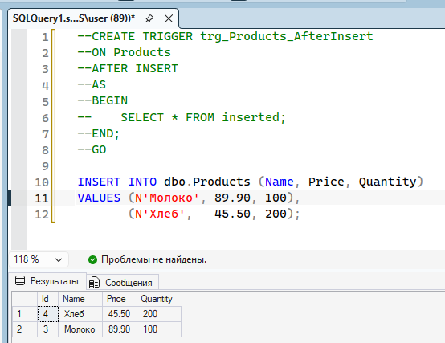
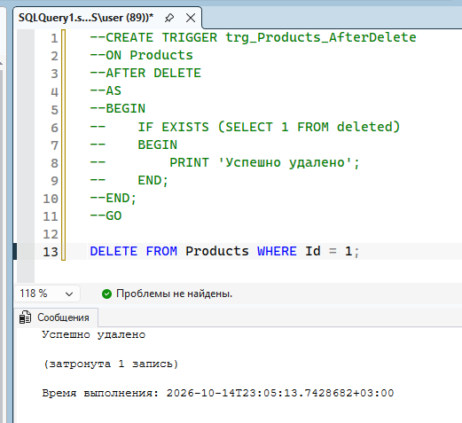
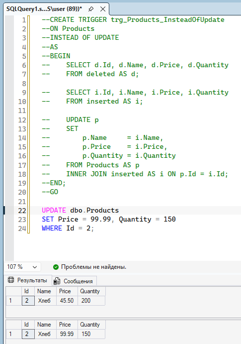
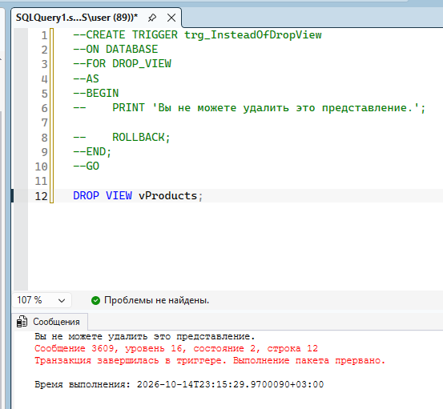
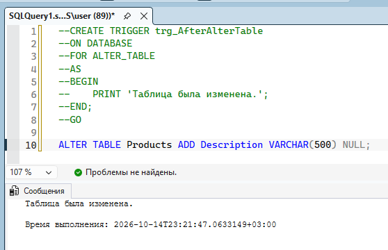

СУТЬ ЗАДАНИЯ:
    Потренироваться в создании триггеров: создать 3 разных триггера для таблицы, и 2 разных триггера для БД. 
    Я решила использовать разные операторы + разный порядок активации триггеров (до и вместо выполнения операции).

=== DML-триггеры ===

1. AFTER INSERT - вставляем значения и выводим их, чтобы убедиться, что всё корректно вставилось
    

2. AFTER DELETE - сообщаем об успешном удалении
    

3. INSTEAD OF INSERT - вместо простого изменения данных: выводим данные до изменения, меняем данные, выводим данные после изменения. Тут используются таблицы inserted и deleted - соответственно копии строк с новыми вставленными значениями, и копия строк до изменения (с удалёнными значениями)
    

=== DDL-триггеры ===

1. Запрет на удаление представлений. ROLLBACK нужен для отмены удаления, поскольку в DDL триггерах конструкция inctead of не работает.
    
2. Просто сообщение об изменении таблицы (у мня кончилась фантазия)
    