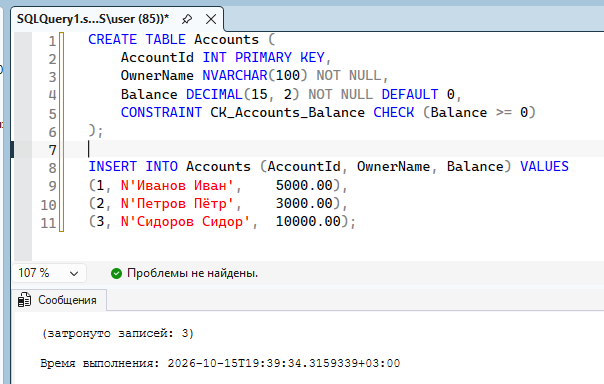
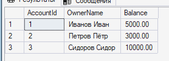
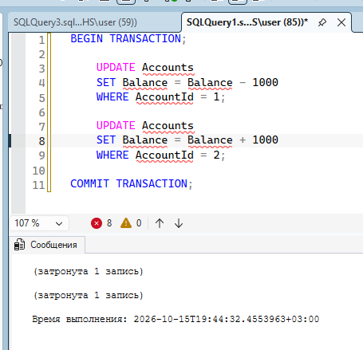
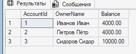
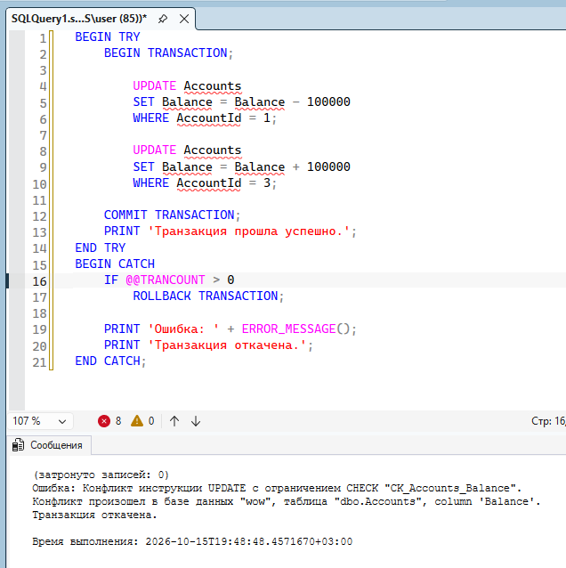
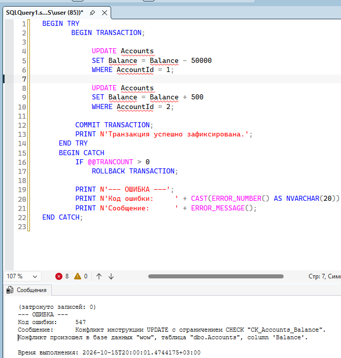
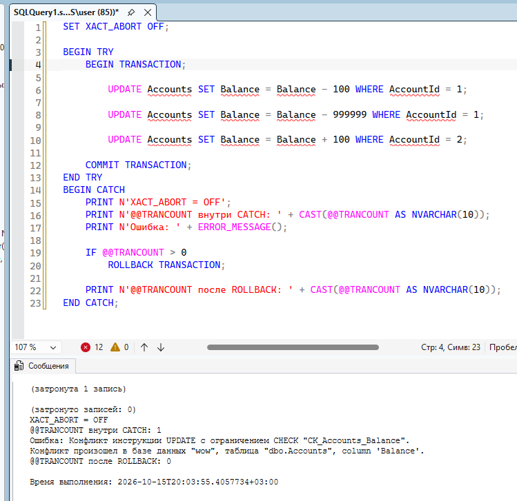
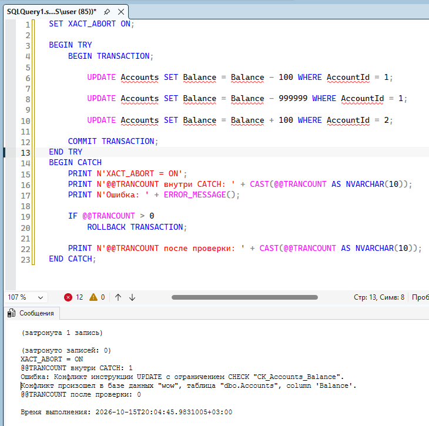
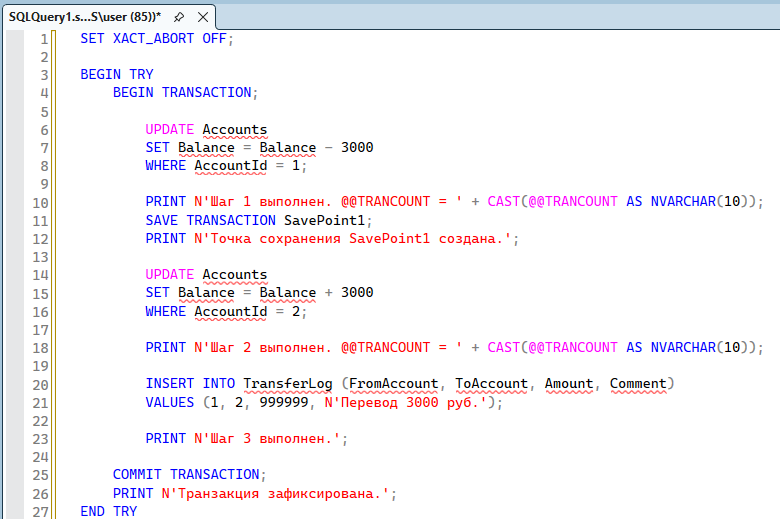
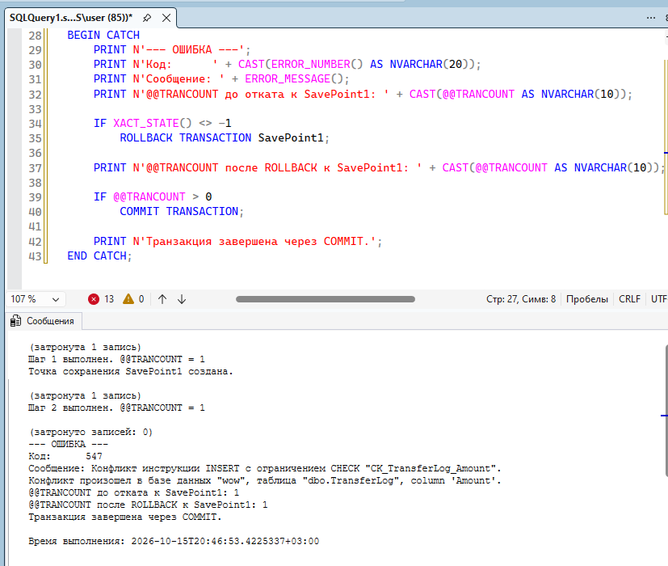

## Задание 1. Основы транзакций (BEGIN/COMMIT/ROLLBACK)

### Создание таблицы

### Транзакция перевода

**Счета до переводов**

**Перевод**

**Счета после переводов**

### Транзакция с ошибкой

В данном случае из-за ограничения CHECK на столбце Баланса в транзакции возникла ошибка: недостаточно средств для перевода (баланс становится отрицательным). Try catch ловит эту ошибку и выполняет откат транзакции до начального состояния.

## Задание 2. Обработка ошибок с TRY...CATCH и XACT_ABORT

**Транзакция внутри TRY-CATCH блока**

**XACT_ABORT = OFF**

**XACT_ABORT = ON**

**Разница режимов при возникновении ошибок**

| XACT_ABORT OFF | XACT_ABORT ON |
| :--- | :--- |
| Нужен ручной ROLLBACK | Транзакция откатывается автоматически |
| Транзакция остаётся "висеть" после возникновения ошибки  | Транзакция откатывается ПОЛНОСТЬЮ автоматически при возникновении ошибки |

## Задание 3. Вложенные транзакции и SAVE TRANSACTION

**Почему ROLLBACK TRANSACTION SavePoint1 не уменьшает @@TRANCOUNT**
Потому что сейвпоинт не является вложенной транзакцией: он просто отображает точку сохранения внутри транзакции. Следовательно, откат к точке не отменяет транзакции

## Задание 4. Уровни изоляции и аномалии чтения

| Уровень | Поведение при аномалии чтения |
| :--- | :--- |
| READ UNCOMMITTED | Читает грязные данные ещё до коммита. Не блокируется. |
| READ COMMITTED   | Ожидает завершения транзакции сессии 1. После COMMIT читает изменённые данные. Предотвращает гряное чтение, но не неповторяющееся чтение: каждый отдельный SELECT внутри транзакции видит свой собственный свежий снимок данных (snapshot) — только то, что уже было зафиксировано (COMMIT) к началу этого конкретного запроса |
| REPEATABLE READ | Ожидает завершения транзакции сессии 1. После COMMIT читает изменённые данные. Предотвращает и грязное чтение, и неповторяющееся: транзакция создает единый снимок данных не для каждого отдельного запроса, а на момент начала всей транзакции (или первого оператора чтения). Все последующие запросы в этой транзакции работают строго с этим же снимком.|
| SNAPSHOT   | Читает значение  на момент начала транзакции. Не блокируется. |