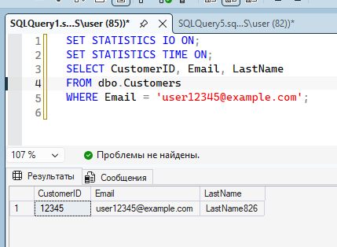
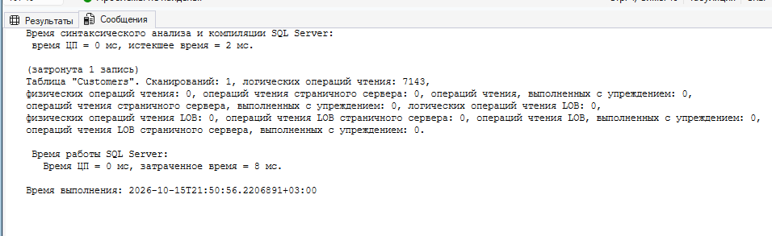
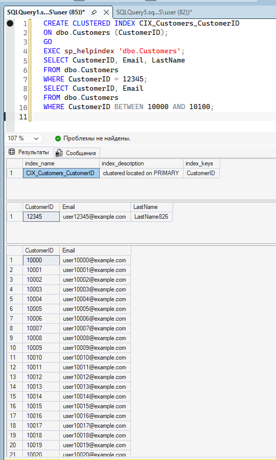
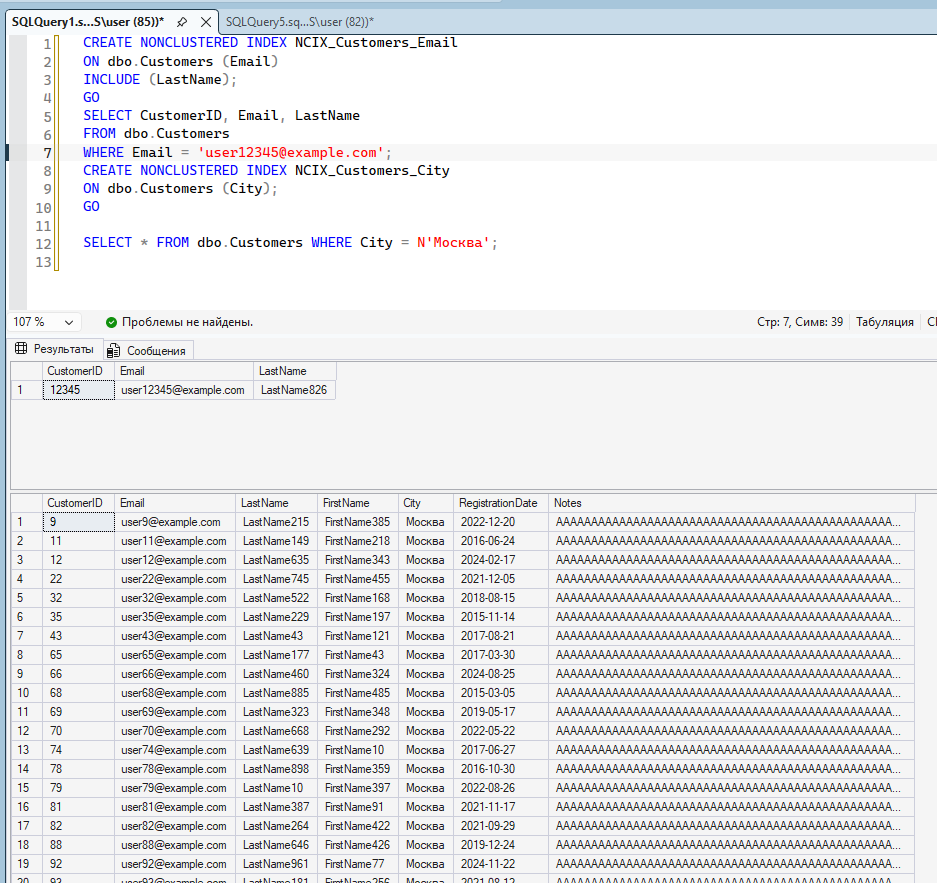
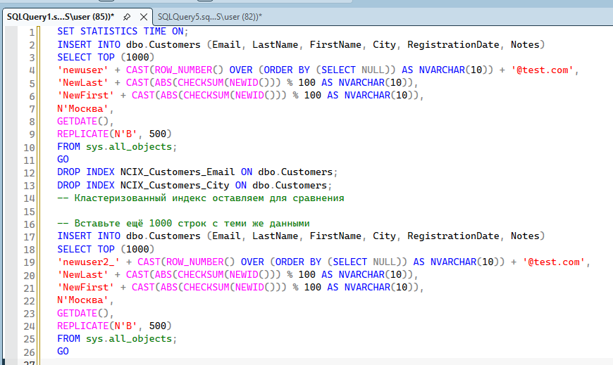
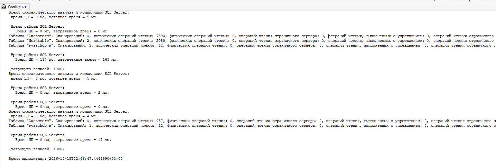
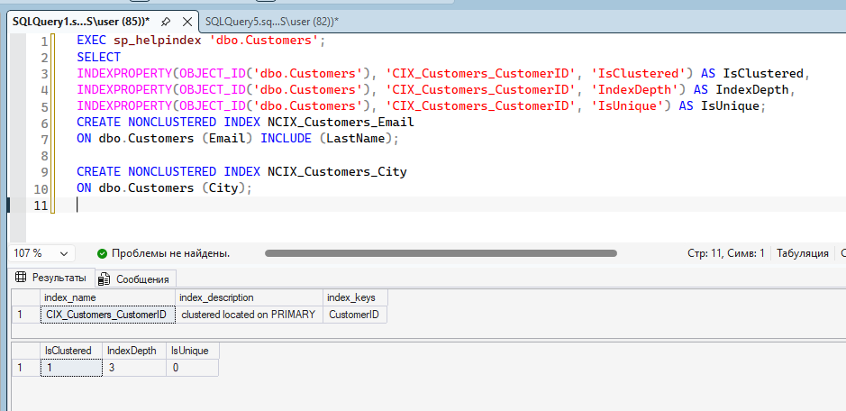

### Сбор статистики запроса

1. **SET STATISTICS IO ON; SET STATISTICS TIME ON;** — эти команды включают сбор статистики о вводе-выводе (I/O) и времени выполнения. Они не меняют данные, а только заставляют SQL Server подробно рассказывать, как он выполнял запрос.
2. Что важно в статистике:
    1. Сканирование (Scan) вместо Поиска (Seek): SQL Server не смог быстро найти нужную строку. Вместо этого он был вынужден прочитать всю таблицу Customers целиком, чтобы найти одну единственную запись с email user12345@example.com. Это называется "сканирование таблицы" (Table Scan) или "кластерное сканирование" (Clustered Index Scan).
    2. 7143 логических чтения: Это количество страниц (по 8 КБ каждая) в памяти, которые SQL Serverу пришлось просмотреть. 7143 страницы — это примерно 57 мегабайт данных.
    3. Физических чтений: 0: Все эти 57 МБ данных уже находились в оперативной памяти (в кэше SQL Server), и серверу не пришлось читать их с жесткого диска. Именно поэтому запрос все равно выполнился быстро (8 мс). Но если данных станет больше (например, миллионы строк), или кэш очистится, этот запрос начнет работать очень медленно.

### Кластеризованный индекс

1. **CREATE CLUSTERED INDEX** - создание кластерного индекса.
    Что это значит физически: Кластерный индекс определяет физический порядок хранения данных в таблице. Теперь строки в таблице Customers будут лежать на диске не в порядке их добавления, а отсортированными по CustomerID.
    Почему это важно: Поскольку CustomerID обычно является первичным ключом (Primary Key), создание кластерного индекса — это стандартная практика. Это как телефонный справочник, где фамилии идут строго по алфавиту.
2. **sp_helpindex** - системная процедура, запрашивает информацию обо всех индексах, которые сейчас есть в таблице
3. **Поиск одной записи** - благодаря созданному кластерному индексу, SQL Server выполнит Index Seek (Поиск по индексу). Он мгновенно перепрыгнет к нужной строке, не читая всю таблицу. Это самый быстрый способ поиска
4. **Поиск по диапазону значений** - поскольку данные физически отсортированы по CustomerID, SQL Server просто находит начало диапазона (10000) и последовательно читает строки до конца диапазона (10100). Это называется Index Range Scan. Это очень эффективно, так как не требует чтения лишних данных.

### Некластеризованный индекс

1. **CREATE NONCLUSTERED INDEX** - создание некластерного индекса.
    Некластерный индекс — это отдельная структура (как алфавитный указатель в конце книги). Он не меняет физический порядок строк в самой таблице. В индексе хранятся значения Email и ссылки (указатели) на соответствующие строки в таблице.
    INCLUDE (LastName) - индекс включает в себя не только Email, но ещё и значения столбца LastName.
    Благодаря INCLUDE, все нужные данные уже лежат внутри индекса, и SQL Serverу не нужно обращаться к самой таблице. Такой индекс называется покрывающим (Covering Index).

### Работа с запросами

**Главный вывод**: Индексы ускоряют чтение (SELECT), но замедляют запись (INSERT, UPDATE, DELETE).

### Explorer

1. **INDEXPROPERTY** - системная функция для получения конкретных характеристик индекса.
    IsClustered = 1 — Подтверждает, что это кластерный индекс (1 = True).
    IndexDepth = 3 — Это глубина индекса (количество уровней в B-дереве). Значение 3 означает, что SQL Serverу нужно сделать 3 "прыжка" по страницам индекса, чтобы найти нужную строку.
    IsUnique = 0 — Индекс не является уникальным. Это значит, что в таблице теоретически могут быть две строки с одинаковым CustomerID (хотя на практике, если это первичный ключ, он должен быть уникальным).