# КОНСПЕКТ

## 1. Принципы системы безопасности серверов БД

| Принцип | Описание |
| :--- | :--- |
| **Избирательный подход** | Каждый пользователь обладает различными правами для работы с объектами БД |
| **Двухуровневая модель доступа** | Безопасность реализуется на двух уровнях: сервер и БД |
| **Использование механизмов** | Аутентификация, авторизация, шифрование |

### Уровни безопасности

| Уровень | Что защищает |
| :--- | :--- |
| Уровень сервера | Доступ к экземпляру SQL Server |
| Уровень БД | Доступ к объектам внутри базы данных |

## 2. Основные понятия

| Термин | Определение |
| :--- | :--- |
| **Учётная запись (принципиал) сервера** | Одна из моделей идентификации пользователя в системе, с помощью которой реализуется аутентификация |
| **Пользователь (принципиал) БД** | Объект БД, с помощью которого определяются все разрешения доступа к объектам БД |
| **Схема** | Набор объектов в БД, объединённых общим пространством имён |
| **Роль** | Именованный набор различных прав |
| **Права** | Разрешения на доступ и действия с объектами сервера или БД |
| **Группа** | Поименованный набор пользователей с одинаковыми правами |

## 3. Режимы аутентификации

| Режим | Описание |
| :--- | :--- |
| **Windows** | `LoginID` хранится в БД `master`, остальные параметры — в структурах Windows NT |
| **MS SQL Server** | Учётная запись (пользователь + пароль), хранится внутри SQL Server |

## 4. Создание учётной записи

### 4.1. Общая схема создания

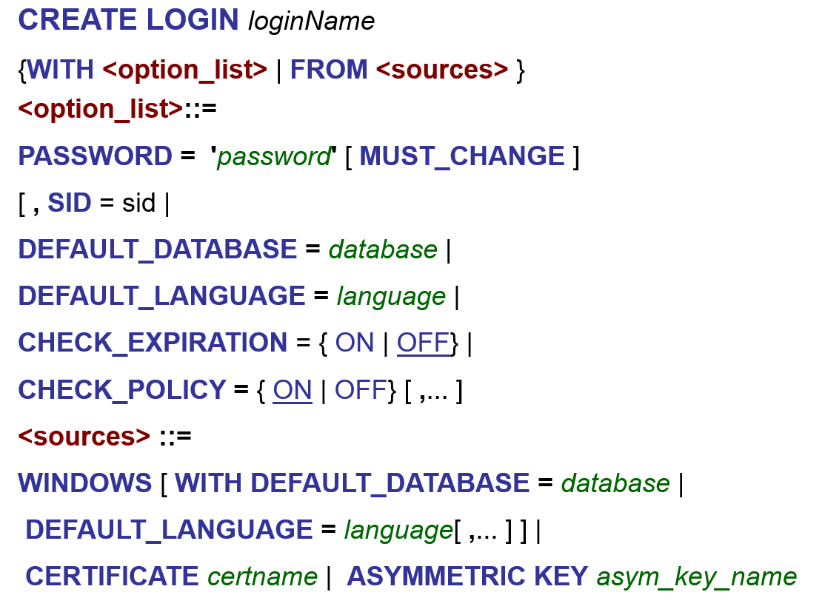

### 4.2. Пример SQL Server

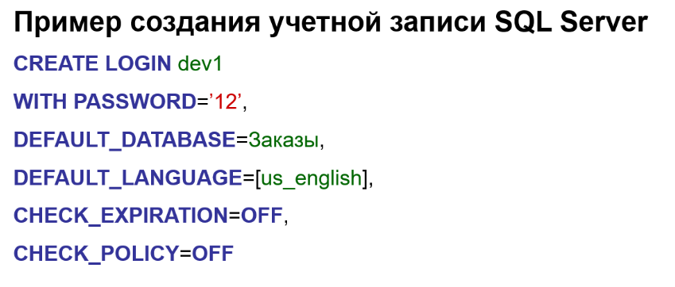

### 4.3. Пример Windows

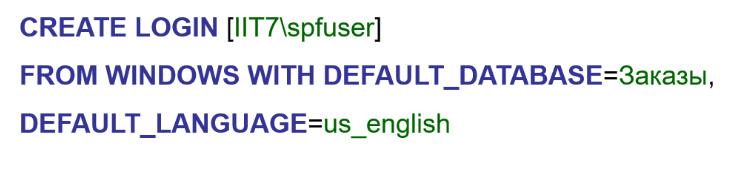

### 4.4. Дополнительные материалы

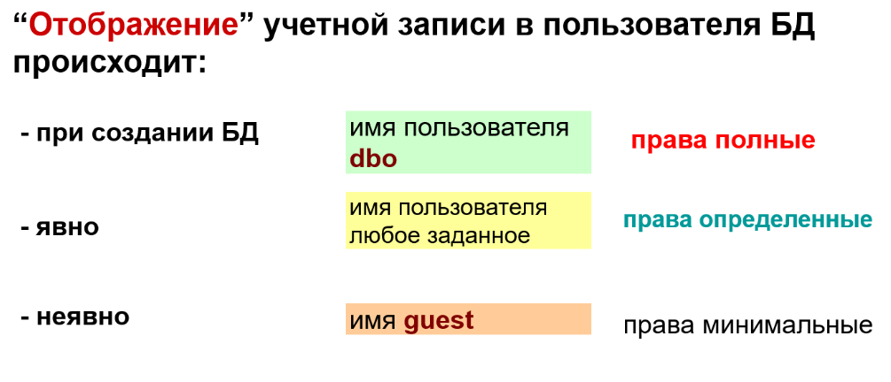

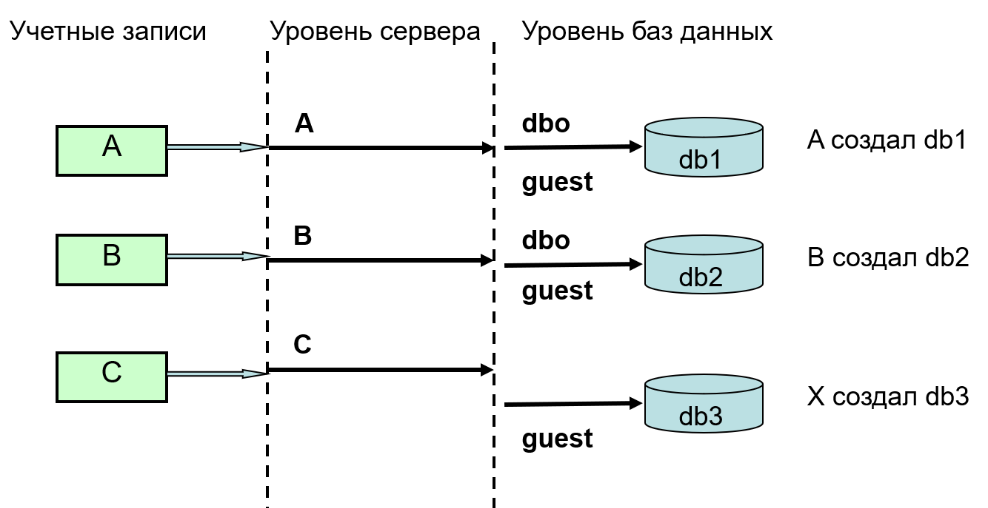

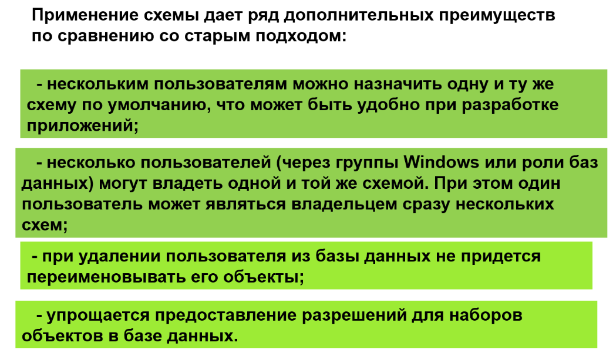

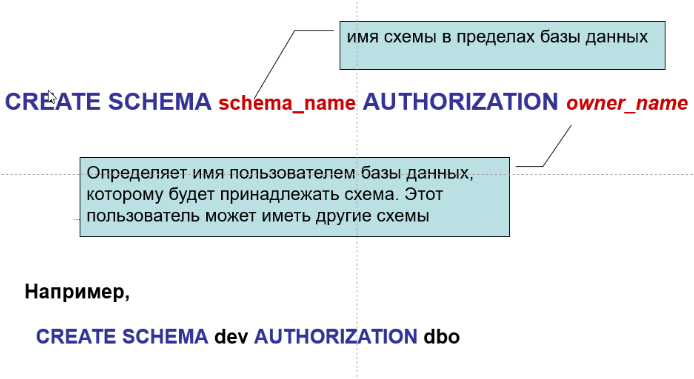

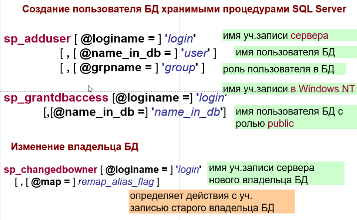

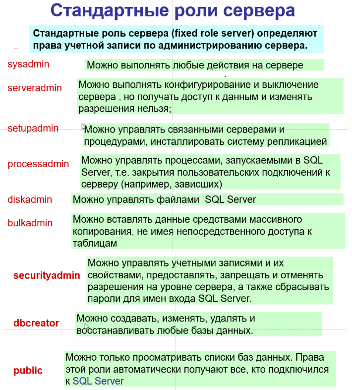

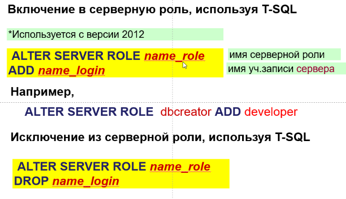

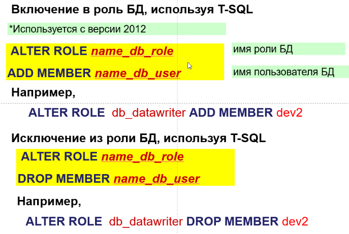

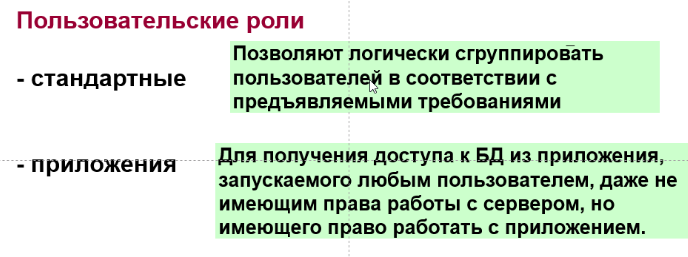

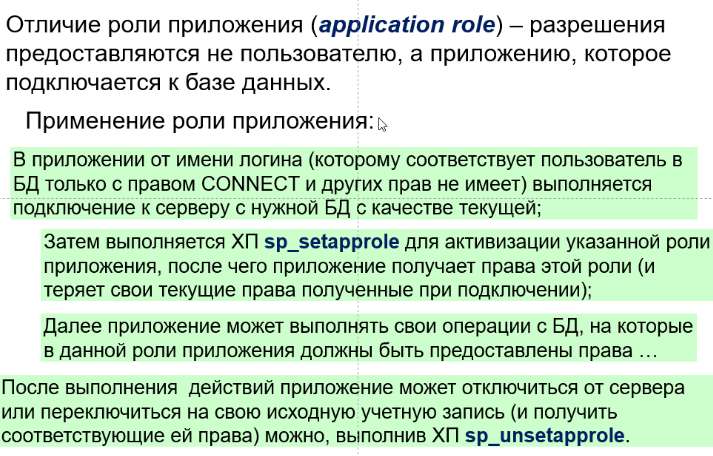

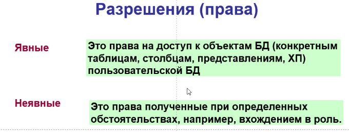

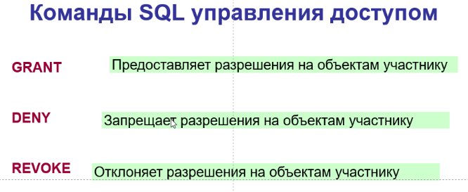

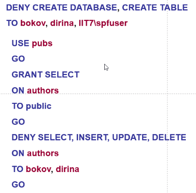