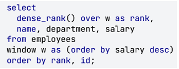
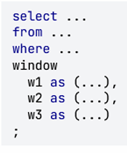
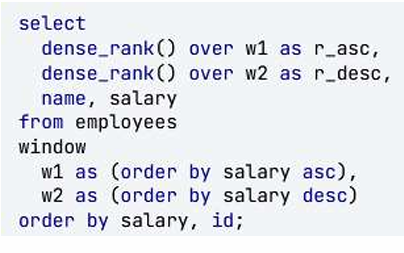
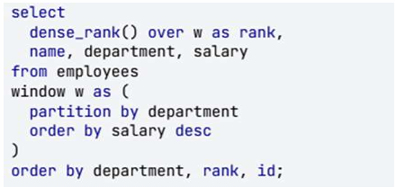
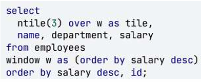
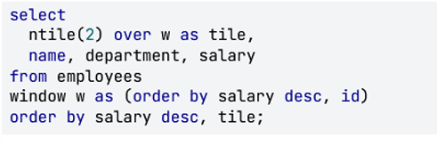
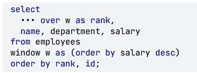
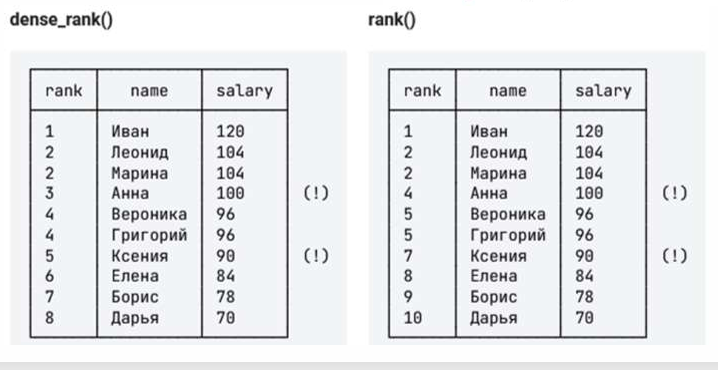

# КОНСПЕКТ

## 1. Задачи, решаемые оконными функциями

| № | Задача | Описание |
| :--- | :--- | :--- |
| 1 | Ранжирование | Всевозможные рейтинги |
| 2 | Сравнение со смещением | Соседние элементы и границы |
| 3 | Агрегация | Сумма и среднее |
| 4 | Скользящие агрегаты | Сумма и среднее в динамике |

## 2. Ранжирование

**Ранжирование** — это всевозможные рейтинги, начиная от призеров чемпионата мира по плаванию и заканчивая Forbes 500.



### 2.1. Определение окна

```sql
window w as (order by salary desc)
```

| Элемент | Назначение |
| :--- | :--- |
| `window` | Ключевое слово, показывающее, что дальше будет определение окна |
| `w` | Название окна (может быть любым) |
| `(order by salary desc)` | Описание окна («значения столбца salary, упорядоченные по убыванию») |

### 2.2. Функция dense_rank()

**dense_rank()** — оконная функция, которая считает ранг по указанному окну.

**Логика работы:** начать с 1 и увеличивать ранг каждый раз, когда очередное значение из окна отличается от предыдущего.

### 2.3. Важное замечание

Конструкция `window` сама по себе ничего не делает с результатами запроса. Она только определяет окно, которое можно использовать (или не использовать) в запросе. Если убрать вызов `dense_rank()`, запрос отработает, как будто нет никаких окон. Окно начинает работать только тогда, когда в `select` появляется оконная функция, которая его использует.

### 2.4. Несколько окон

Если понадобится использовать в запросе несколько окон, просто перечислите их через запятую в разделе `window`.





## 3. Секции окна

```sql
window w as (partition by department order by salary desc)
```

| Элемент | Назначение |
| :--- | :--- |
| `partition by department` | Указывает, как следует разбить окно на секции |
| `order by salary desc` | Задает сортировку внутри секции |



## 4. Группы

Чтобы провести границы между группами, придется анализировать все зарплаты, отсортированные по убыванию. Поэтому окно будет таким:

```sql
window w as (order by salary desc)
```

А вот функция потребуется другая — `ntile(n)`, где `n` — количество групп.

| Особенность | Описание |
| :--- | :--- |
| Разбиение | `ntile(n)` разбивает все записи на `n` групп и возвращает номер группы для каждой записи |
| Неравномерность | Если общее количество записей не делится на размер группы, то первые группы будут крупнее последних |
| Одинаковые значения | `ntile()` всегда старается разбить данные так, чтобы группы были одинакового размера. Поэтому записи с одинаковым значением з/п вполне могут попасть в разные (соседние) группы |





## 5. Функции ранжирования

| Функция | Назначение |
| :--- | :--- |
| `row_number()` | Порядковый номер строки. Нумерует строки в порядке, указанном в `order by` |
| `dense_rank()` | Ранг строки |
| `rank()` | Тоже ранг, но с пропусками |
| `ntile(n)` | Разбивает все строки на `n` групп и возвращает номер группы, в которую попала строка |



