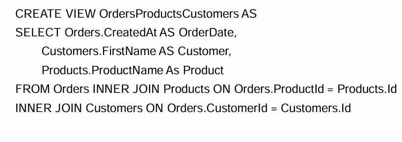
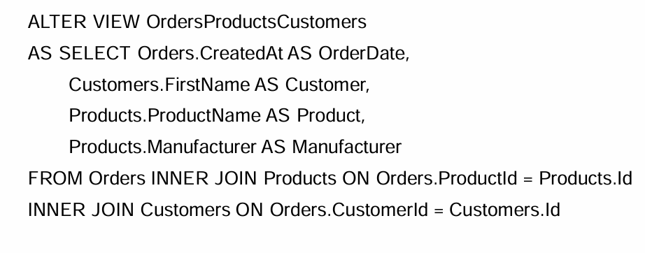

# КОНСПЕКТ

## 1. Основные понятия

**Представление (View)** - Виртуальная таблица, которая содержит запросы, динамически извлекающие используемые данные. В отличие от обычных стандартных таблиц, представления не хранят данные физически 

## 2. Преимущества представлений

| № | Преимущество | Описание |
| :--- | :--- | :--- |
| 1 | Упрощение | Упрощают комплексные SQL-операции |
| 2 | Защита данных | Представления могут дать доступ к части таблицы, а не ко всей таблице |
| 3 | Форматирование | Позволяют возвращать отформатированные значения из таблиц в нужной и удобной форме |

## 3. Типы представлений

1. Индексированные 
2. Секционированные 
3. Системные

## 4. Модифицируемое представление

**Модифицируемое представление** — это представление, при изменении данных в котором эти данные изменятся и в таблицах, которые эти данные хранят. То есть при использовании оператора `UPDATE`/`INSERT`/`DELETE` к представлению, данные обновятся и в таблицах.

### 4.1. Критерии модифицируемого представления

| № | Критерий | Описание |
| :--- | :--- | :--- |
| 1 | Одна базовая таблица | Должно выводиться в одну и только в одну базовую таблицу |
| 2 | Первичный ключ | Должно содержать первичный ключ этой таблицы (технически не предписывается стандартом ANSI, но желательно придерживаться) |
| 3 | Агрегатные функции | Не должно иметь никаких полей, которые бы являлись агрегатными функциями |
| 4 | DISTINCT | Не должно содержать `DISTINCT` в своем определении |
| 5 | GROUP BY / HAVING | Не должно использовать `GROUP BY` или `HAVING` в своем определении |
| 6 | Подзапросы | Не должно использовать подзапросы (ANSI-ограничение, не предписано для некоторых реализаций) |
| 7 | Вложенность | Может быть использовано в другом представлении, но это представление должно также быть модифицируемым |
| 8 | Константы и выражения | Не должно использовать константы, строки или выражения значений (например: `comm * 100`) среди выбранных полей вывода |
| 9 | INSERT и NOT NULL | Для `INSERT` должно содержать любые поля основной таблицы, которые имеют ограничение `NOT NULL`, если другое ограничение по умолчанию не определено |

## 5. Создание

## 6. Изменение

## 7. Удаление

