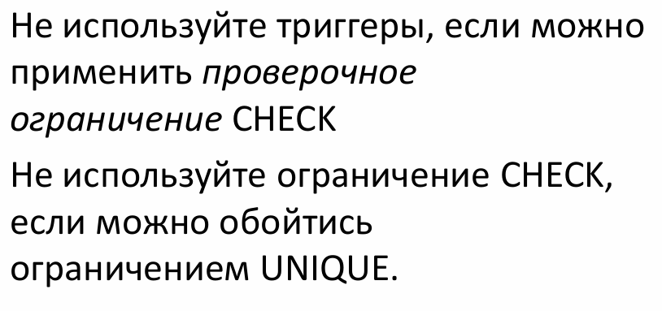
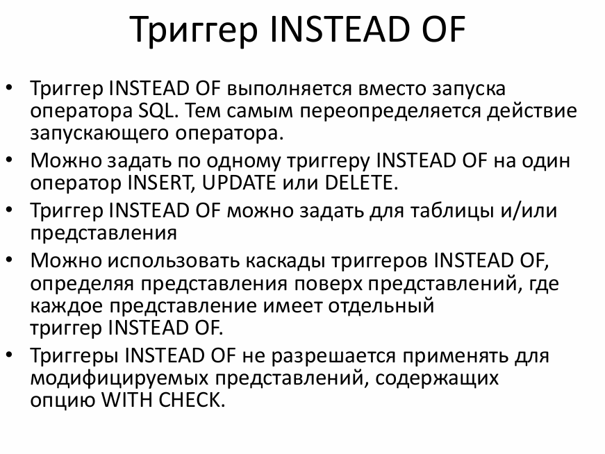
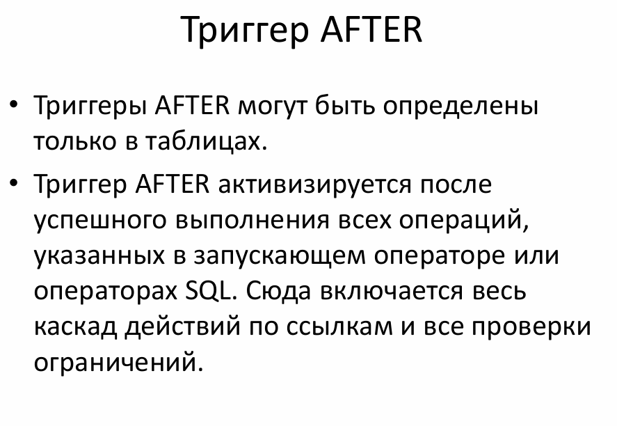
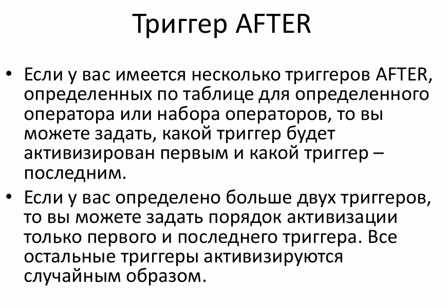
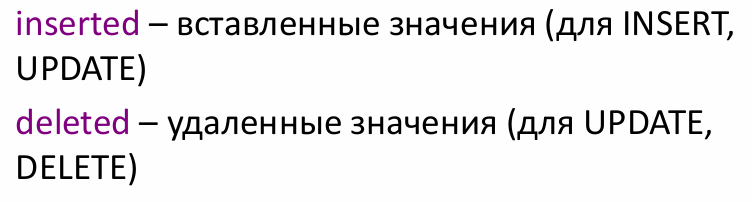
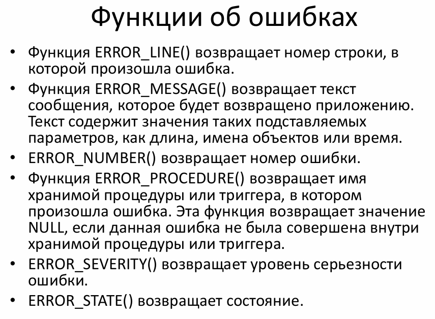
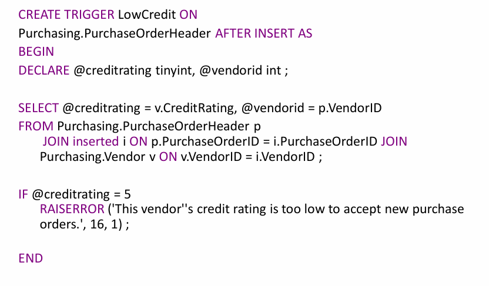
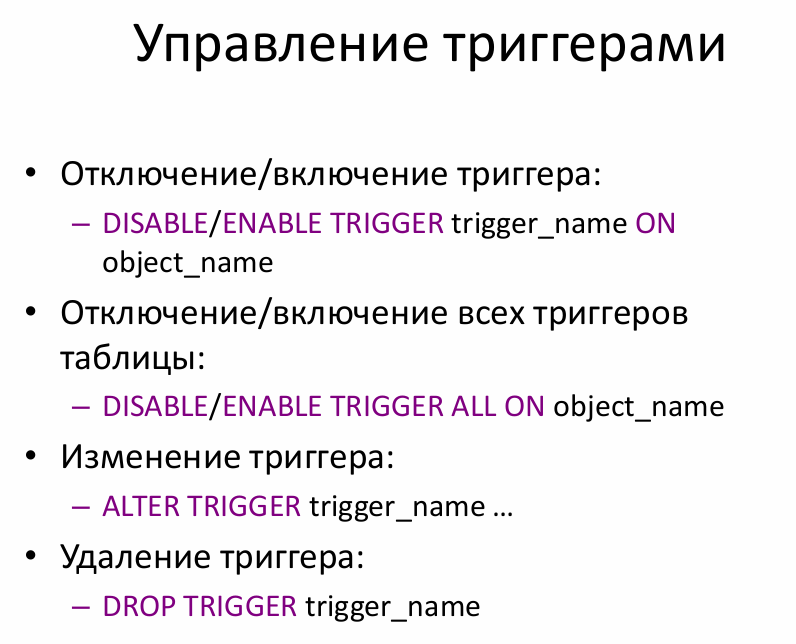

# КОНСПЕКТ

## 1. Основные понятия

*Триггер** - Откомпилированная SQL-процедура, исполнение которой обусловлено наступлением определенных событий внутри реляционной базы данных 

### 1.1. Свойства триггеров

| № | Свойство | Описание |
| :--- | :--- | :--- |
| 1 | Событийность | Исполнение обусловлено наступлением определенных событий внутри реляционной базы данных |
| 2 | Отсутствие параметров | Не имеет параметров |
| 3 | Единое целое | Становится «одним целым» с вызвавшей операцией |

## 2. Виды триггеров

| № | Вид | События |
| :--- | :--- | :--- |
| 1 | DML | `insert`, `delete`, `update` |
| 2 | DDL | `create`, `drop`, `after` |
| 3 | Logon | — |

## 3. DML-триггеры

| № | Особенность | Описание |
| :--- | :--- | :--- |
| 1 | Привязка | Триггер создается по одной таблице базы данных |
| 2 | Доступ | Может осуществлять доступ и к другим таблицам и объектам других баз данных |
| 3 | Ограничения | Триггеры нельзя создать по временным таблицам или системным таблицам, а только по определенным пользователем таблицам или представлениям |

### 3.1. Компоненты DML-триггера

| Компонент | Описание |
| :--- | :--- |
| **Объект** | Таблица, `VIEW` |
| **Событие** | `insert`, `update`, `delete` для таблицы и для `VIEW` |
| **Время активации** | До (вместо) или после выполнения оператора |

## 4. Тип триггера

### 4.1. Триггеры INSTEAD OF

**Триггеры INSTEAD OF используются для:**

1. Выборочного запрещения исполнения команды, для которой определен триггер (проверки предусловия) 
2. Подсчета значений столбцов до завершения команды `INSERT` или `UPDATE`

### 4.2. Триггеры AFTER

**Триггеры AFTER используются для:**

1. Учета выполненных операций 
2. Проверки пост-условий исполнения команды 

## 5. Таблицы deleted и inserted

При создании триггера вы имеете доступ к двум временным таблицам с именами `deleted` и `inserted`. Они хранятся в памяти, а не на диске.

| Особенность | Описание |
| :--- | :--- |
| Структура | Эти две таблицы имеют одинаковую структуру с таблицей (одинаковые колонки и типы данных), по которой определяется данный триггер |
| Хранение | Хранятся в памяти, а не на диске |

## 6. Функции ошибок

## 7. Пример триггера

## 8. Управление триггерами

## 9. DDL-триггеры

| № | Особенность | Описание |
| :--- | :--- | :--- |
| 1 | Применение | Триггеры DDL могут быть использованы в административных задачах, таких как аудит и регулирование операций базы данных |
| 2 | Область действия | Действие этих триггеров распространяется на все команды одного типа во всей базе данных или на всем сервере |

### 9.1. Задачи DDL-триггеров

Задача 
1. Предотвратить внесение определенных изменений в схему базы данных 
2. Выполнить в базе данных некоторые действия в ответ на изменения в схеме базы данных 
3. Записывать изменения или события схемы базы данных 
4. Триггеры DDL срабатывают только после выполнения соответствующих инструкций DDL. Триггеры DDL нельзя использовать в качестве триггеров INSTEAD OF 

## 10. Logon-триггеры

**Триггеры входа** выполняют хранимые процедуры в ответ на событие `LOGON`. Это событие вызывается при установке пользовательского сеанса с экземпляром SQL Server.

Триггеры входа срабатывают после завершения этапа проверки подлинности при входе, но перед тем, как пользовательский сеанс реально устанавливается 