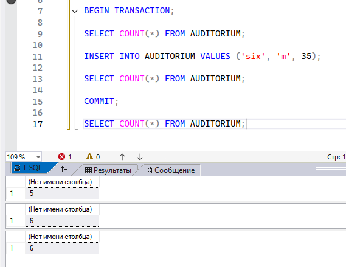
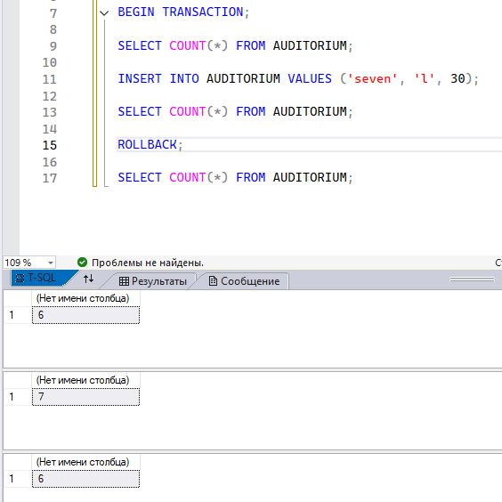
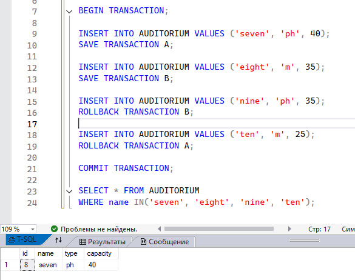
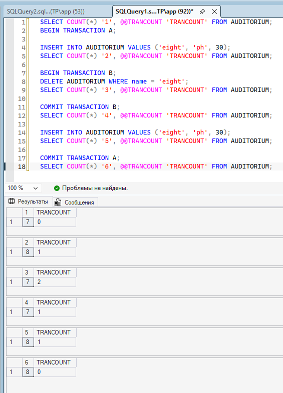
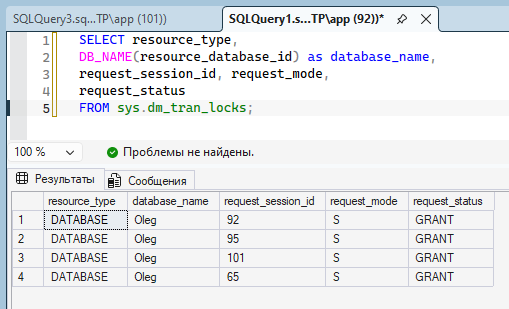
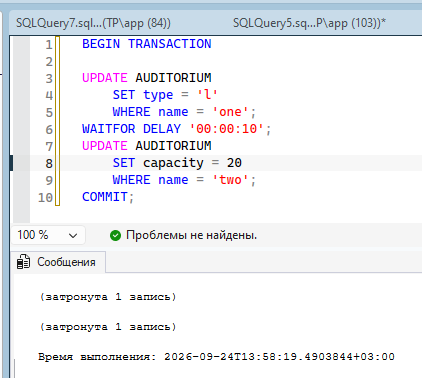
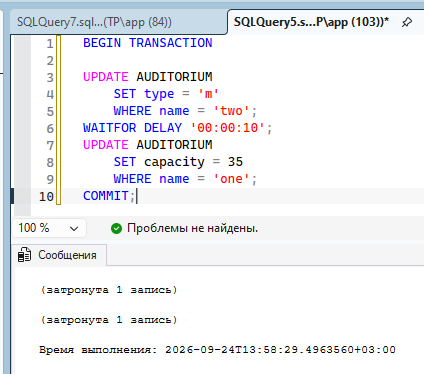
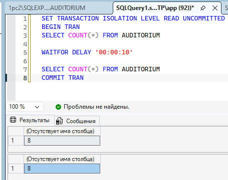
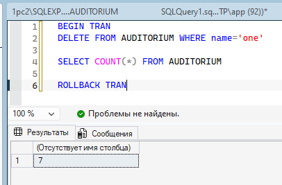
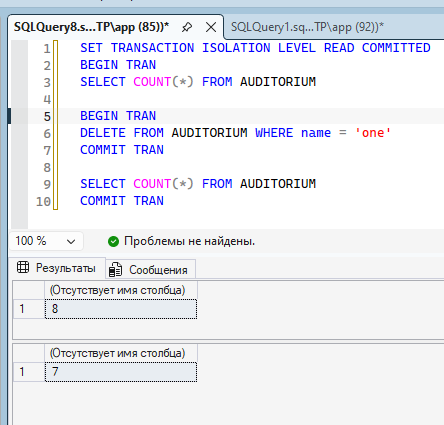

== ПРАКТИКА == 

1. Простая транзакция

    1.  BEGIN TRANSACTION - объявление начала транзакции
    2. Просмотр количества строк в таблице до добавления новых данных
    3. Добавление новых данных
    4. Проверка количества строк - их стало на 1 больше из-за вставки
    5. COMMIT - подтверждение транзакции (все изменения внутри транзакции сохраняются)
    6. Проверка, что изменения действительно сохранились

2. Транзакция с откатом 

    1. По факту здесь происходит всё то же самое, но вместо COMMIT - подтверждения транзакции - делается ROLLBACK - откат транзакции. Т.е. все операции внутри транзакции откатываются к моменту начала транзакции и не сохранаются.

3. Транзакции с сохранением и последующим откатом

    1. Начинаем транзакцию
    2. Вставляем данные и сохраняем состояние транзакции с именем А
    3. Вставляем данные ещё раз и делаем второе сохранение с именем В
    4. Вставляем данные ещё раз и откатывает транзакцию до точки В - предыдущие действия всё ещё сохранены внутри транзакции, но последующее действие отменено
    5. Вставляем данные ещё раз и откатываем транзакцию А - отменяются все действия, кроме самой первой вставки
    6. Подтверждаем транзакцию -  в результате из всех вставленных строк осталась только самая первая.

4. Подсчёт количества выполняемых транзакций

    @@TRANCOUNT отображает уровень вложенности транзакции:
        1. Транзакция не открыта - уровень 0
        2. Транзакция открыта - уровень 1
        3. Внутри транзакции открывается ещё одна транзакция - уровень 2 и т.д

5. Просмотр блокировок датабазы. Блокировка - это занятость данных какой-либо транзакцией или процессом, т.е. данные блокируются от посторонних действий в момент выполнения действия.

    
    1. resource_type - тип заблокированного ресурса
    2. DB_NAME(resource_database_id) - имя заблокированного ресурса в виде имени
    3. request_session_id - айди сессии, которое держит блокировку
    4. request_mode - тип блокировки. S - разделяемая блокировка, т.е её могут одновременно держать несколько сессий (например, на чтение)
    5. equest_status - статус запроса на блокировку. GRANT - блокировка уже предоставлена

5. Deadlock - должны вызываться ошибка о взаимоблокировке, но он слишком умный и всё выполняет как надо

    Здесь была попытка вызвать конфликт во взаимных блокировках: две сессии блокируют разные строки, ставят изменения на паузу, и пытаются внести изменения в заблокируемые строки соседней сессии -> не могут, поскольку строки уже заблокированы -> бесконечно ждут друг друга, пока блокировка не снимется.

6. Параллельные транзакции с READ UNCOMMITTED
1 транзакция

2 транзакция

    1. READ UNCOMITTED - уровень изоляции, при котором одна транзакция может читать неподтверждённые изменения второй транзакции
    2. Одна транзакция читает данные, уходит на паузу, вторая - в этот момент меняет данные. Первая транзакция снимается с паузы, читает данные и видит изменения внутри. Это называется "грязным чтением".

7. произошли технические шоколадки

8. READ COMMITTED неповторяющееся чтение

    1. READ COMMITED - можно читать только те данные, которые были зафиксированы.
    2. В данном случае не может произойти грязного чтения, но может произойти Неповторяющееся чтение - в промежутках между чтением вторая транзакция меняет данные, и в итоге при двух разных чтениях результаты отличаются. Т.е данные не заблокированы от изменений в момент выполнения транзакции.