# Первая часть 

## Задание 1. Создание кластеризованного индекса на heap-таблице

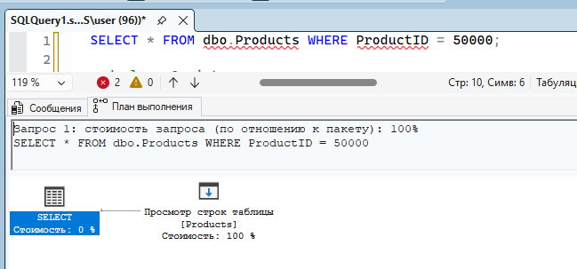
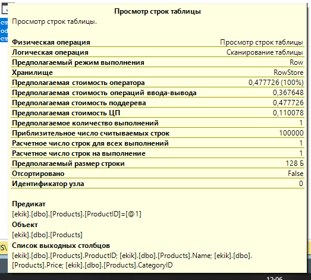

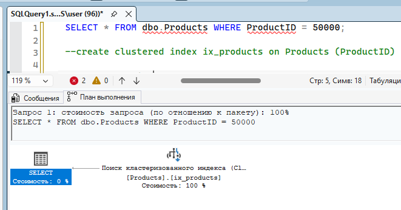
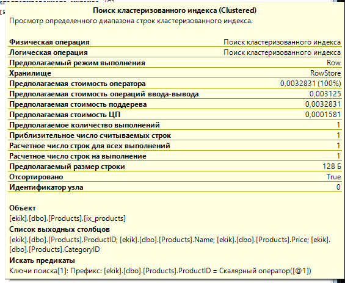

## Задание 2. Некластеризованный индекс для точечного поиска
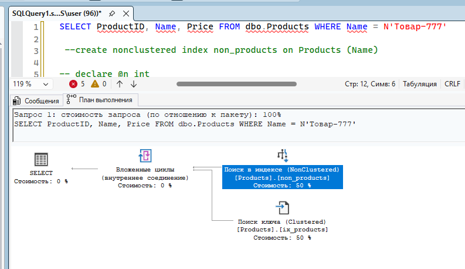

## Задание 3. Разница между Seek и Scan
1. Происходит единичный поиск по индексу, так что используется обычный поиск, а не сканирование.
   
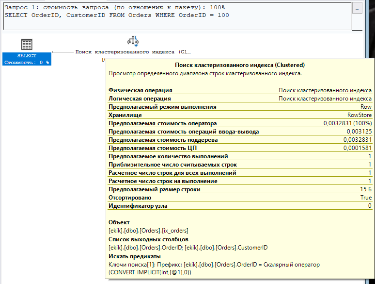
    
3. Поиск происходит по диапазону, но этот диапазон сильно уже полного набора данных, так что использовать обычный поиск тут быстрее (ну или программа так считает хз). Программа просто сразу прыгает к индексу и читает до ограничительного второго индкеса
   
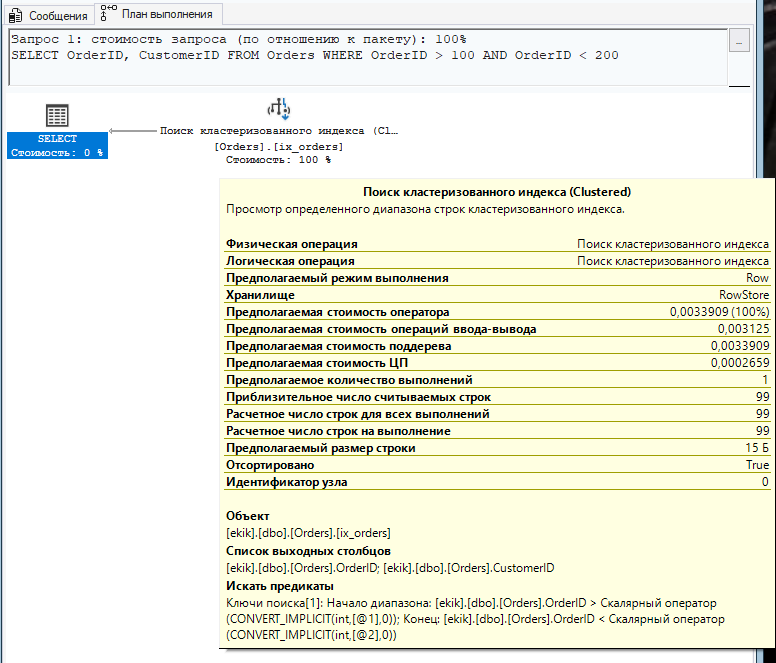

4. Тут нужно просто прочитать все строки, так что последовательное чтение дешевле. Причём тут он ищет по некластеризованному индексу
   
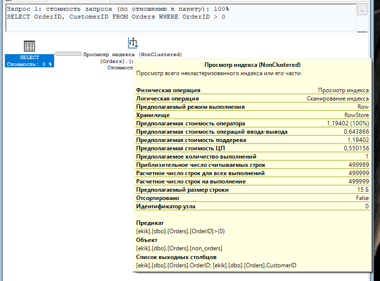

## Задание 4. Влияние selectivity на выбор индекса
1. Тут игнорируется индекс поскольку легче просто пройтись по всем строкам, чем прыгать по страницам с помощью индексов (выборка 50% из вех строк)
   
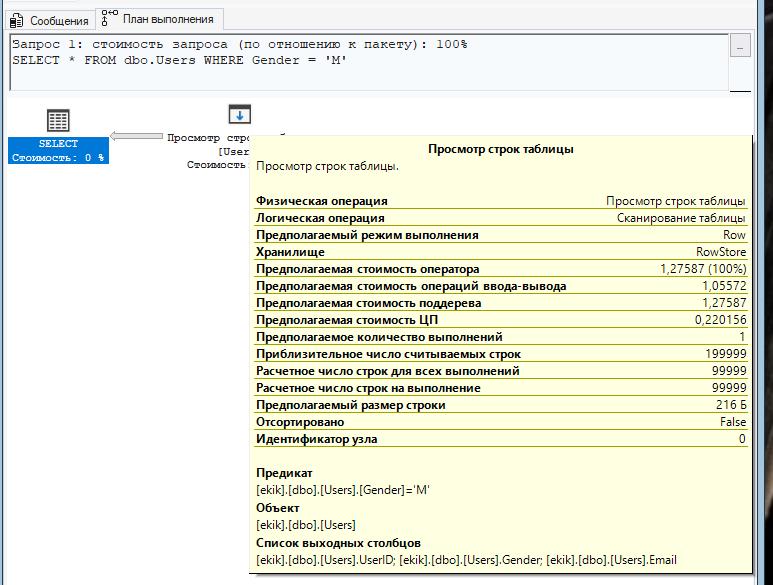
3. Почта уникальная - происходит точечный поиск по индексу. Посколько SELECT выбирает все строки, то после нахождения почты ищутся ещё и связанные с ней столбцы (уточняющий запрос)
   
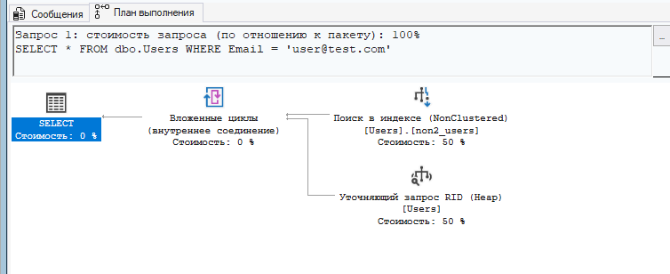

## Задание 5. Удаление и пересоздание индекса
1. Создаём смотрим
   
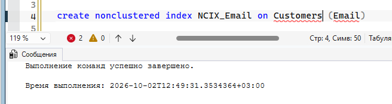
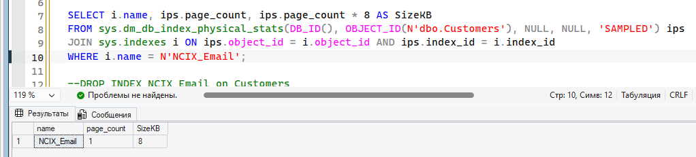

3. Удаляем пересоздаём смотрим
   
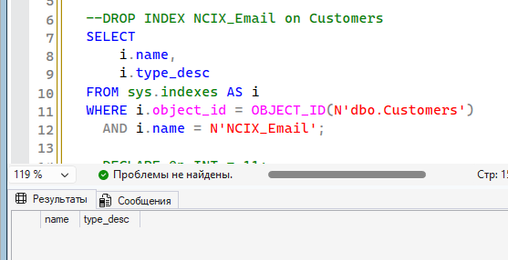
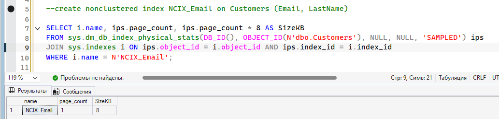

я ваще не поняла чота оно одинаковое я хз. запросы на прорсмотр у нейронки просила потому что видит бог я не понимаю этот арабский

## Задание 6. Covering index через INCLUDE

1. Индекс без INCLUDE. Происходит Key Lookup - TotalAmount не включён в индекс, так что запросу приходится искать его отдельно.
   
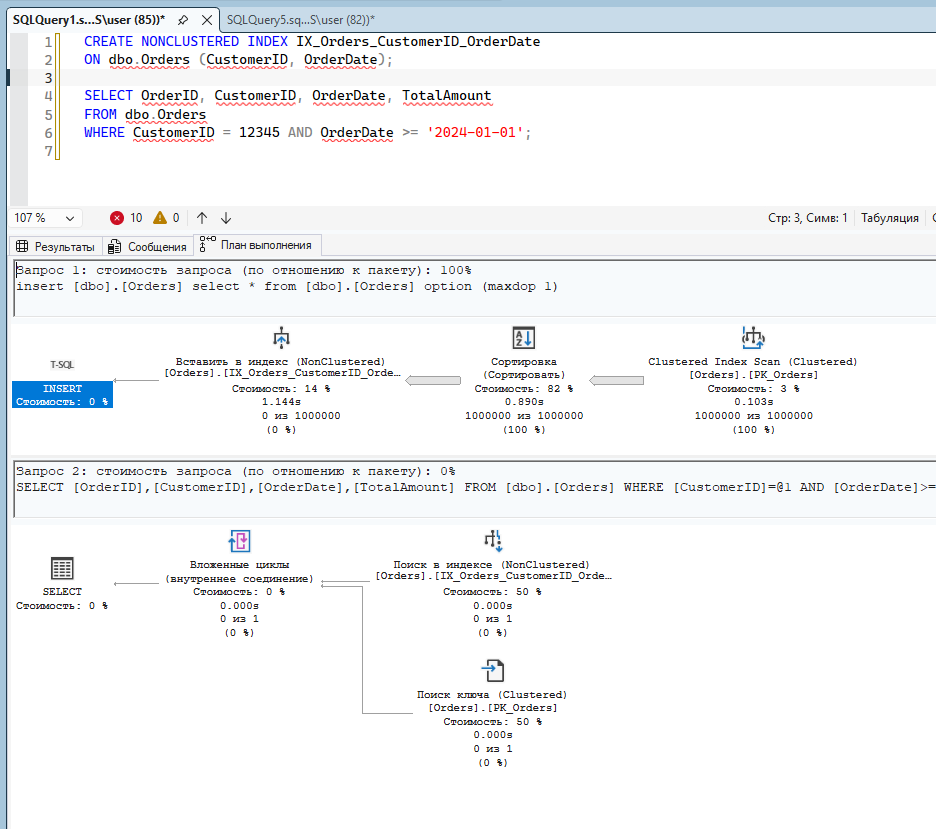

3. Индекс с INCLUDE. Key Lookup устранён - TotalAmount включён в индекс и запросу не надо искать его отдельно.
   
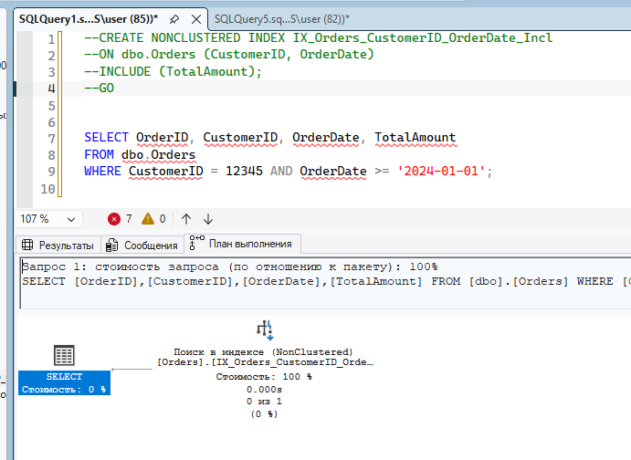

## Задание 7. Порядок столбцов в составном индексе

1. Создание индексов
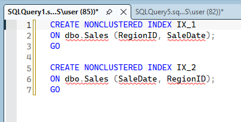

2. Первый запрос
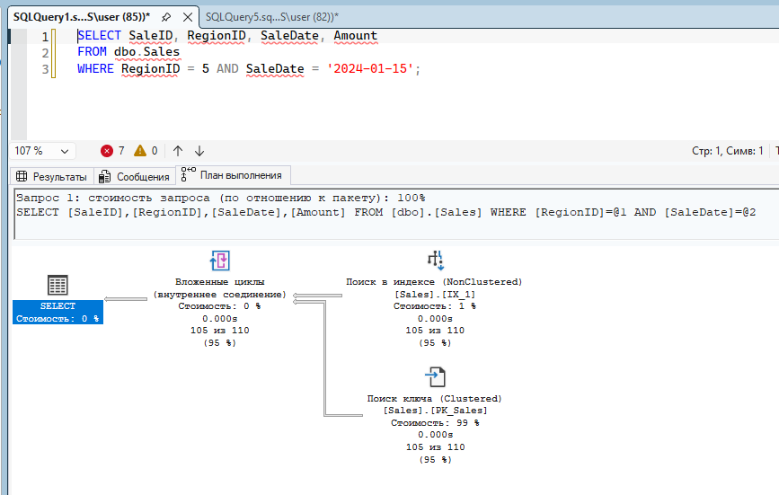
**Результат**: SQL Server выберет IX_1 (RegionID, SaleDate), потому что оба столбца из условия являются ключевыми в этом индексе, и SQL Server может выполнить Index Seek сразу по двум столбцам.

3. Второй запрос
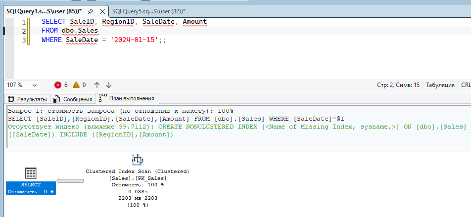
**Результат**: SQL Server проигнорировал IX_2 (SaleDate, RegionID), потому что счёл Clustered Scan дешевле.
IX_2 (SaleDate, RegionID) не является покрывающим для этого запроса. В индексе есть SaleDate и RegionID, но нет SaleID и Amount. Если SQL Server использует IX_2 для поиска строк с SaleDate = '2024-01-15', ему придётся для каждой найденной строки делать Key Lookup в кластерный индекс, чтобы достать SaleID и Amount.

4. Левый префикс
Составной индекс — это структура B-дерева, где строки отсортированы сначала по первому столбцу, потом внутри одинаковых значений первого — по второму столбцу, и так далее. SQL Server может быстро найти данные только если в условии есть левый (первый) столбец индекса. 
Составной индекс (A, B) может использоваться для поиска по A, по (A, B), но не по B в одиночку.
Порядок столбцов в индексе критичен: на первое место нужно ставить тот столбец, который чаще всего встречается в WHERE в одиночку или имеет высокую селективность.

5. Принцип SARGable
SARGable (Search ARGument able) — это условие, которое может быть использовано для Index Seek. Условие SARGable, если столбец стоит в левой части сравнения без обёрток (функций, арифметики, приведений типов).
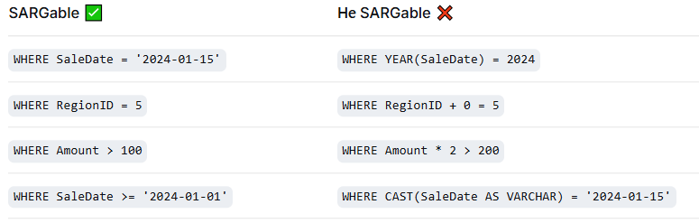

## Задача 8. Кластеризованный индекс vs. heap для диапазонных запросов

1. Тест на heap
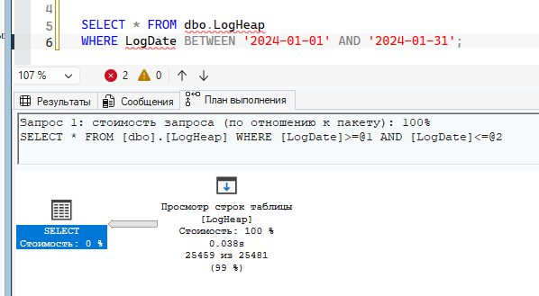
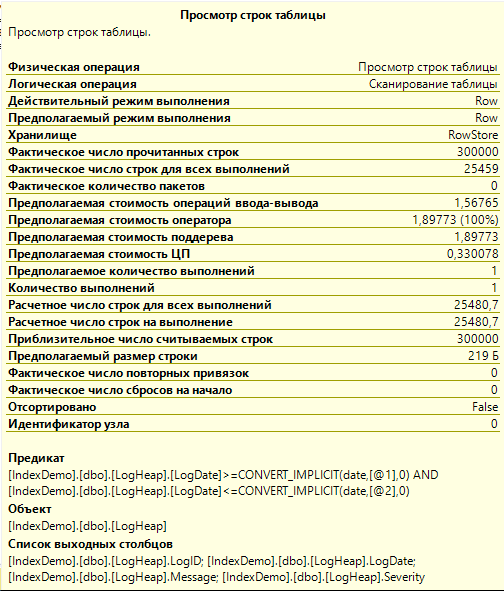
Heap — это неупорядоченная куча страниц. У SQL Server нет способа быстро найти строки по диапазону LogDate — он не знает, в каких страницах лежат нужные даты. Приходится читать все страницы таблицы и фильтровать строки построчно.

2. Тест на clustered
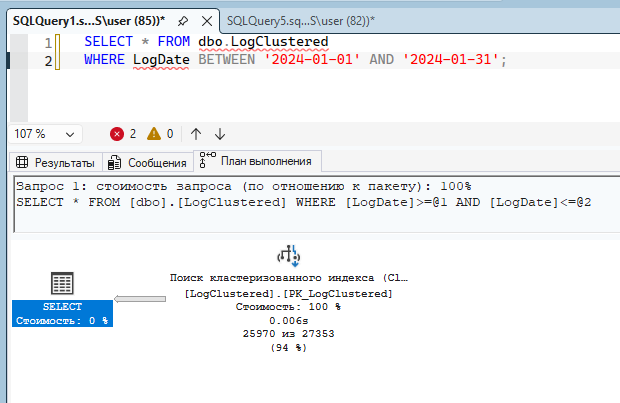
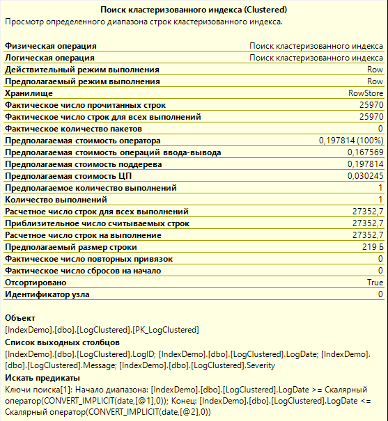
Данные физически отсортированы по LogDate. SQL Server в B-дереве кластерного индекса находит начало диапазона (2024-01-01) и конец диапазона (2024-01-31), а затем последовательно читает только те страницы, где лежат эти даты. Остальные ~11 месяцев данных даже не читаются с диска.

3. Почему кластерный индекс радикально ускоряет диапазонные запросы
    1. Физическая сортировка данных: Кластерный индекс — это B-дерево, в листьях которого лежат сами строки таблицы, отсортированные по ключу (LogDate).
    2. Механизм Index Seek (Range). SQL Server делает два спуска по B-дереву: находит первую страницу и  последнюю страницу, затем читает только страницы между этими двумя точками. Все остальные страницы физически не читаются.

# Вторая часть 

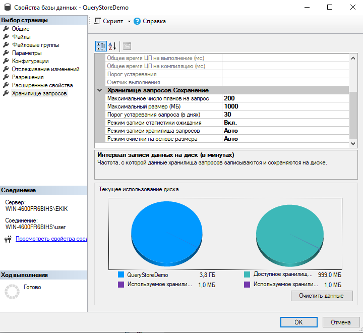

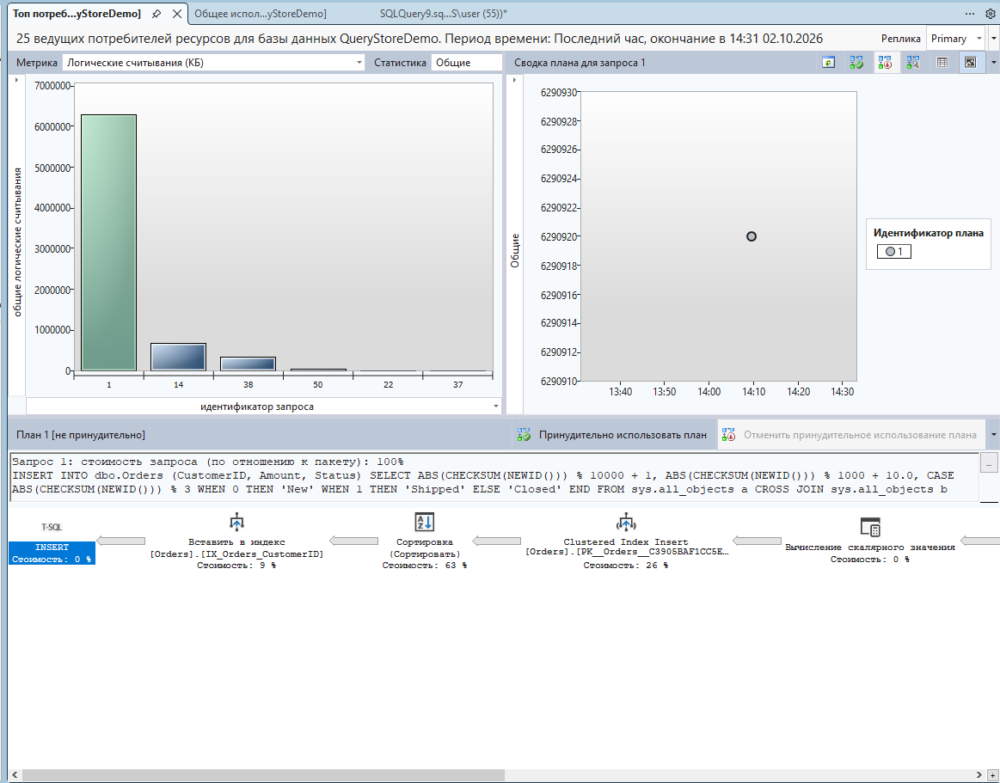
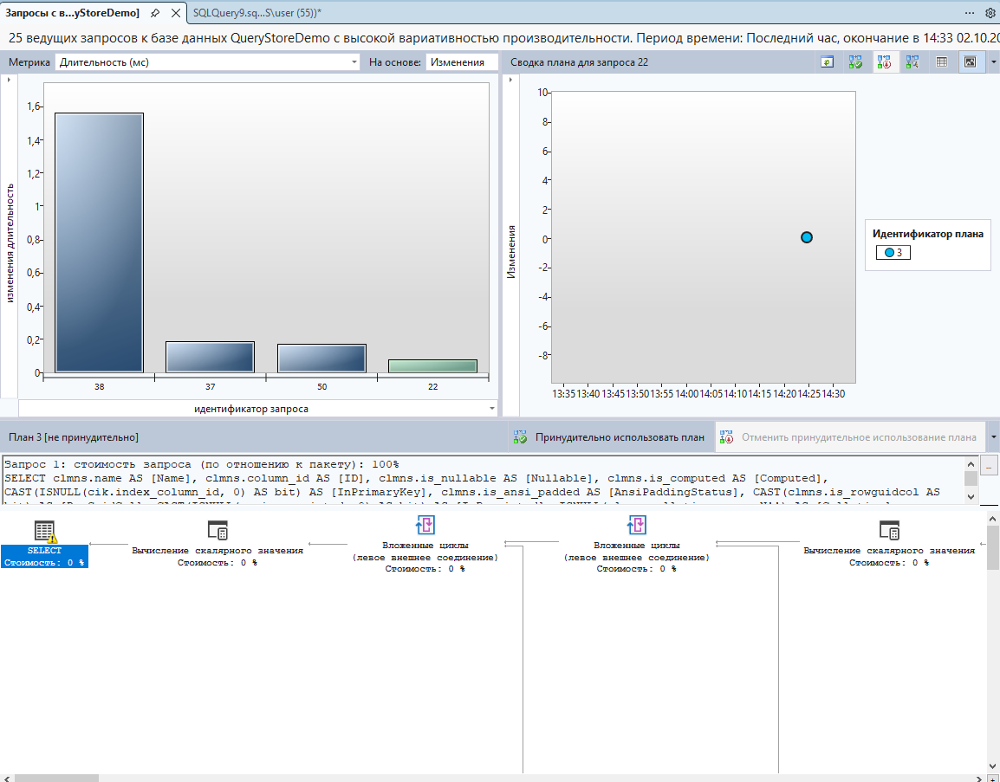

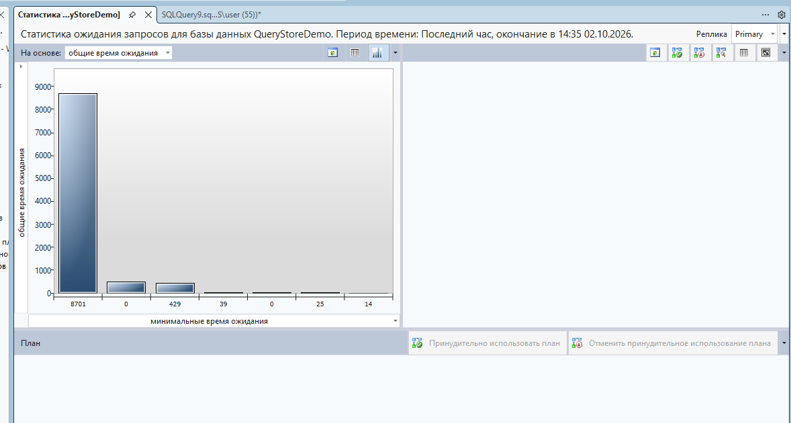
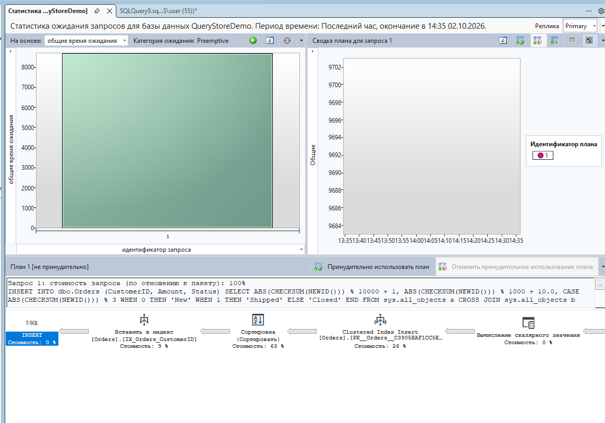
