## Создание пользователей сервера и БД, создание схемы

### Создание учётной записи MS SQL Server

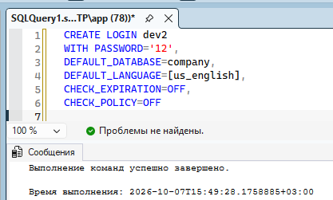

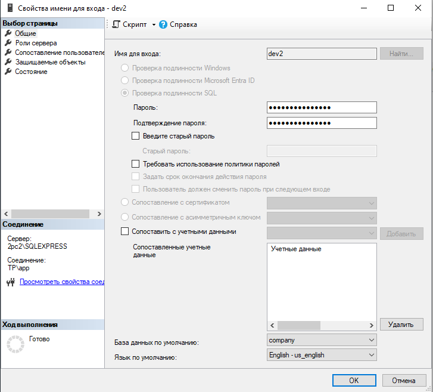

### Создание учётной записи Windows NT

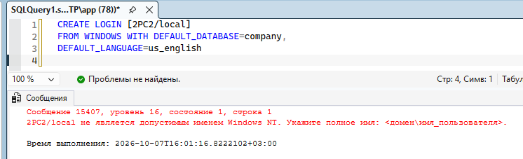

тут у меня нет прав, так что оно так и продолжит жаловаться

### Создание учётной записи через хранимую процедуру

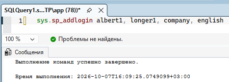
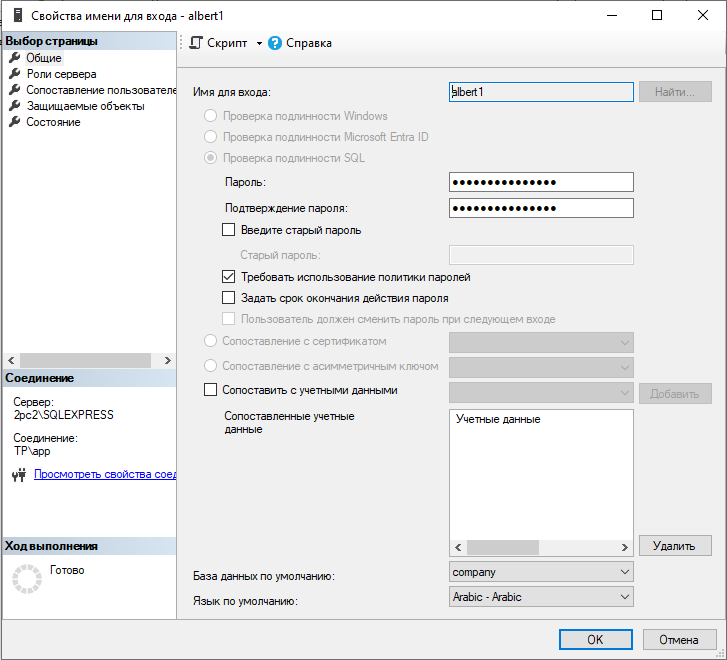

Тут есть примеры системных процедур
https://infocenter.sybase.com/help/index.jsp?topic=/com.sybase.dc36273_1251/html/sprocs/X25636.htm

### Создание схемы

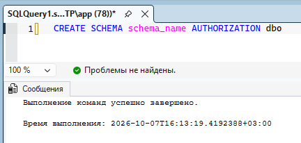
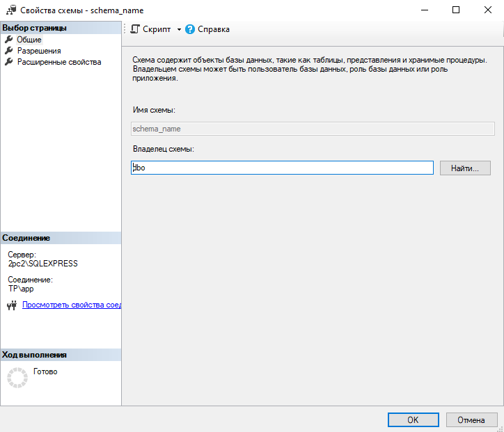

### Создание пользователя БД

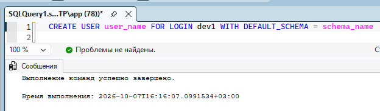
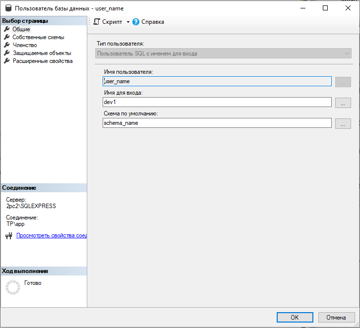

### Создание пользователя БД с помощью хранимой процедуры

1. sp_adduser - можно задать роль пользователя через group_name

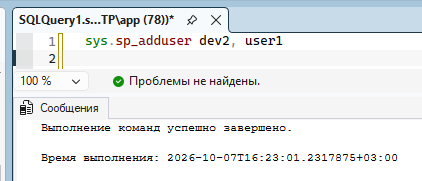
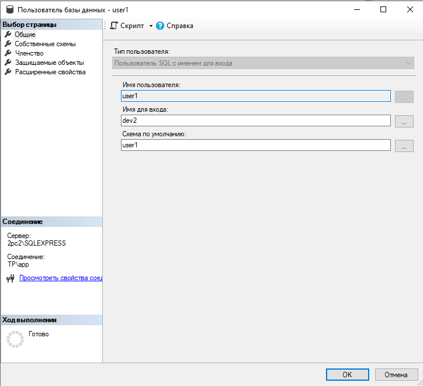

2. sp_grantbaccess - создаётся с ролью public

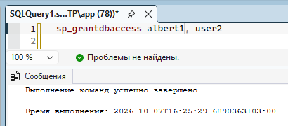
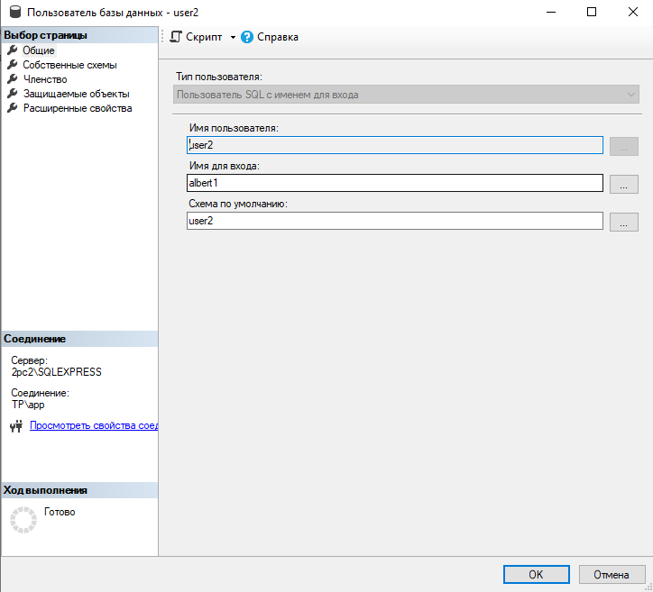

3. sp_changedbowner 'login' - меняет владельца БД

## Назначение ролей

### Назначение ролей сервера с помощью ХП

1. Добавление

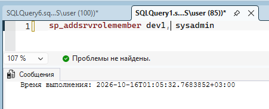
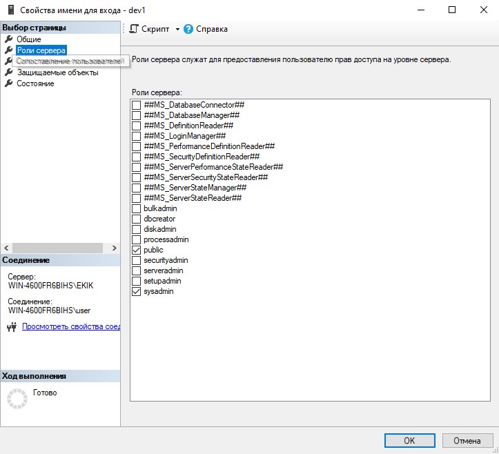

2. Исключение

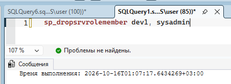
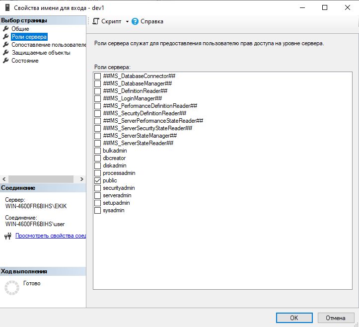

### Назначение ролей сервера с помощью TSQL

1. Добавление

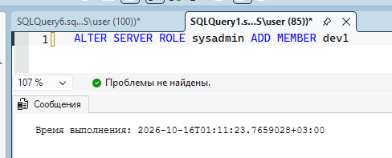

2. Исключение

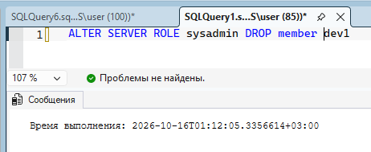

### Назначение ролей БД с помощью ХП

1. Добавление

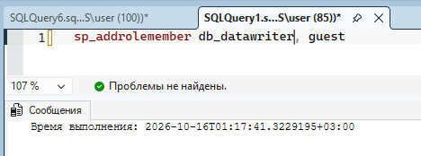
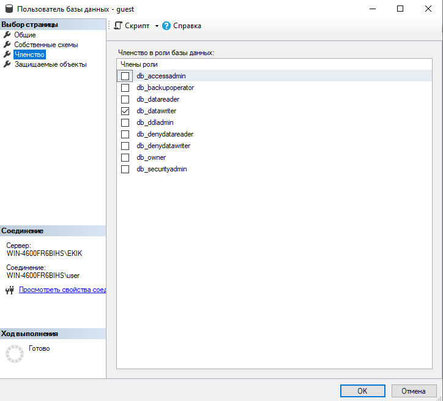

2. Исключение

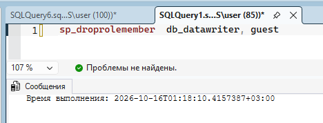
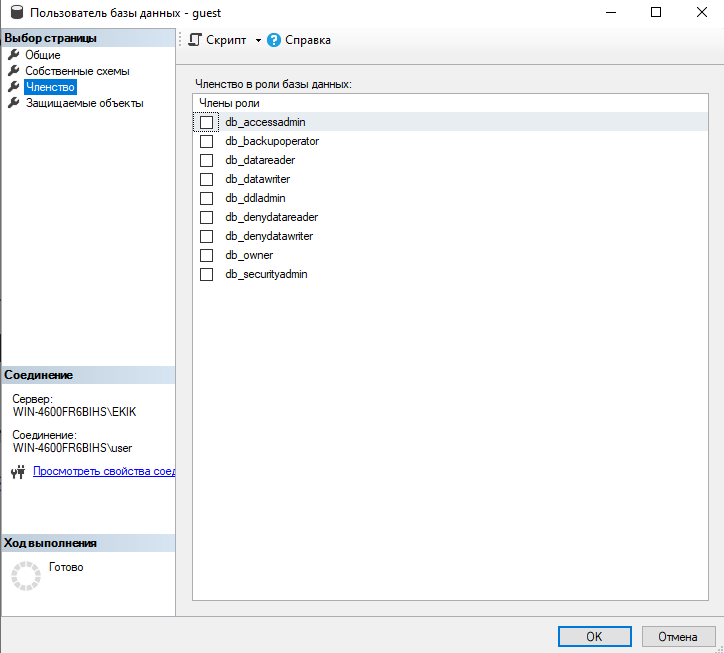

### Назначение ролей БД с помощью TSQL

1. Добавление

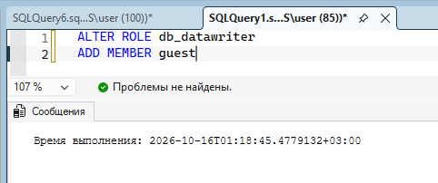

2. Исключение

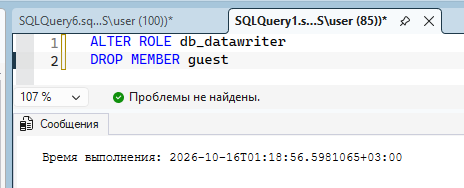

## Права доступа

1. Выдача прав

1) Права на работу внутри таблицы

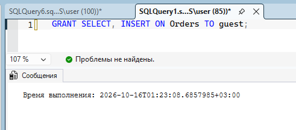
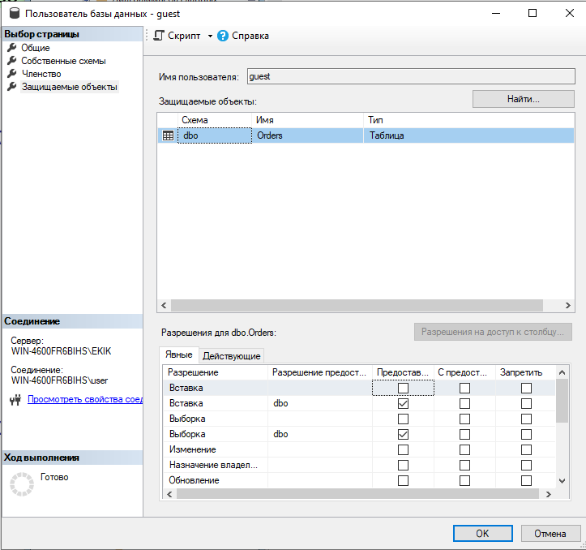

2) Права на работу по серверу

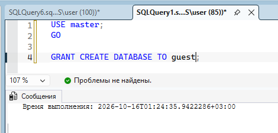

2. Отбор прав

1) Права на работу внутри таблицы

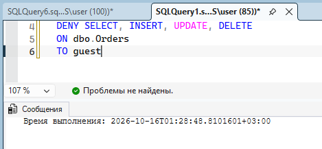
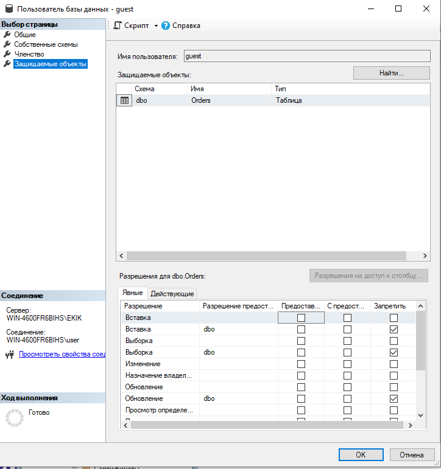

2) Права на работу по серверу

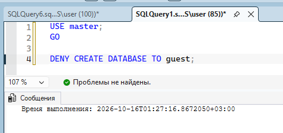