# БИЛЕТ 10

## Задание 2

### Оконные функции для анализа аномалий.

Оконные функции позволяют находить аномалии с помощью:
1. rank - пропуски в рангах, дубликаты.
2. Row_Number - пробелы, пропуски
3. Агрегатные функции - скользящее среднее и стандартное отклонение на заданном интервале.

### Представление для отчёта по аномалиям

Представления позволяют "выделять" значения из таблицы на основе определённых признаков, что может быть полезно для анализа аномалий

## Задание 3

### 1. READ UNCOMMITTED - грязное чтение

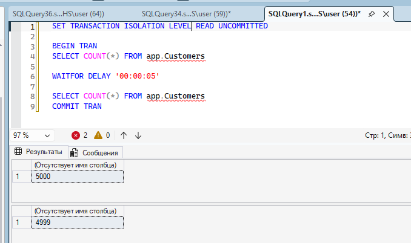

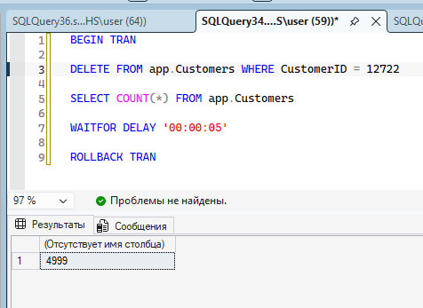

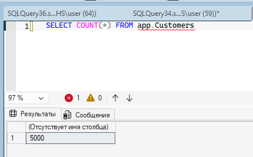

1) Транзакция А читает количество данных - 5000, уходит на паузу
2) Транзакция B удаляет одну строку и читает количество - 4999, уходит на паузу
3) Транзакция А выходит с паузы и читает количество данных - видит "грязные данные", которые были изменеы транзакцией B, но ещё не закоммичены
4) Транзакция В выходит с паузы и откатывает удаление -> в итоге данных осталось 5000, но транзакция А уже прочитала 4999

### 2. READ COMMITED - неповторяющееся чтение

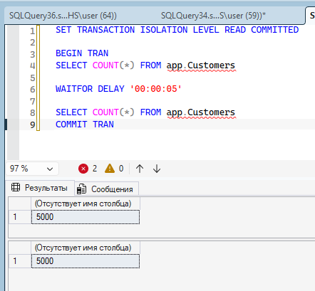

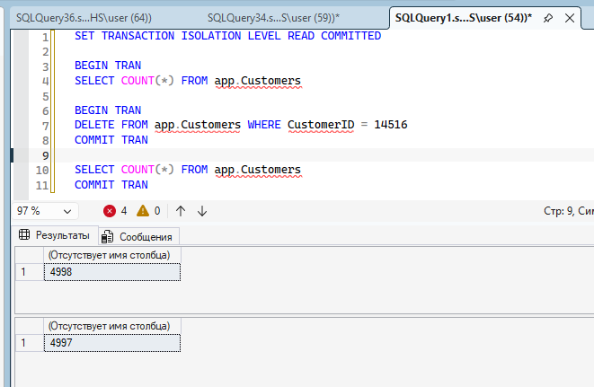

1) Грязного чтения не происходит: транзакция не читает данные, изменённые другой сессией, но не закоммиченные
2) Происходит Неповторяющееся чтение: транзакция всё ещё читает новые данные, которые были закоммичены

### 3. Фантомное чтение

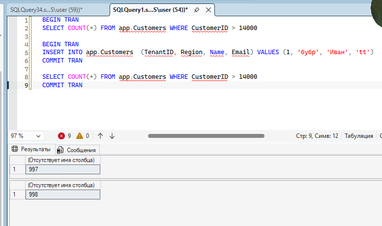

1) Первая транзакция читает данные с выборкой where - одно количество строчек
2) Вторая транзакция добавляет строку
3) Первая транзакция опять читает данные, и видит на одну строку больше

### 4. sys.dm_tran_locks

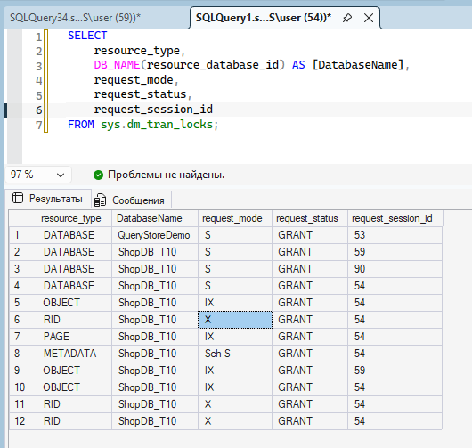

sys.dm_tran_locks позволяет просматривать список текущих блокировок

S - разделяемая, для чтения
X - используется для изменений данных, блокирует всё остальное
IX - отображает, что сейчас будут меняться данные
Sch-S - защищает таблицу от удаления во время выполнения запроса

## Задание 4

### План при разных уровнях

1. Предполагаемый план - выполняется до выполнения запроса и содержит оценочную статистику

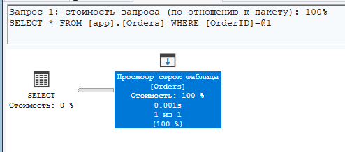

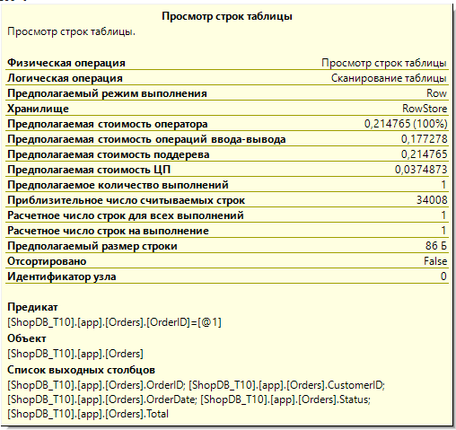

2. Фактический план - отображает статистику после завершения работы запроса

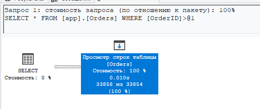

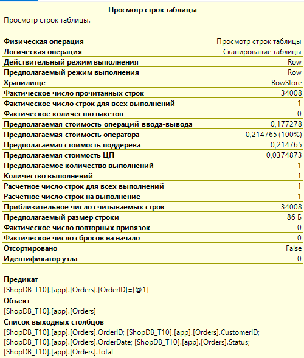

### Влияние индексов на изоляцию

При отсутствии индексов программа будет должна наложить блокировку на всю таблицу, т.к она будет вынуждена читать всю таблицу целиком.
При наличии индекса - программа будет смотреть данные именно по ним, что сужает количество читаемых данных в таблице и снижает количество блокировок (блокировки по конкретным строкам).
При покрывающем индексе программа, когда программа читает только покрывающиеся поля, то количество обращений, следовательно, блокировок, снижается к минимууму.
Чем меньше данных читает запрос, тем меньше риск взаимоблокировок и аномалий.

### SARGable при разных уровнях.

SARGable - принцип, который позволяет СУБД эффективно использовать индексы. (без лишних операций)
1. На уровне синтаксиса: запрос должен содержать агрегатные функции только с правой стороны запроса, т.е:

WHERE CustomerID > 1400 - 12

а не

WHERE CustomerID - 12 > 1400

(это странный пример но он тут нужен чисто для демонстрации самого принципа)

2. На уровне типов: запрос должен содержать тот же тип данных, что и у искомых значений индекса. В противном случае программе придётся делать приведение типов

3. На уровне операторов: and - подходит, поскольку позволяет искать по значению индекса (а значения без индекса УЖЕ не подходят), а or заставит искать вне значений индекса.

## Задание 5

### Роли для тестирования

Роли бывают как и дял всего сервера, так и для конкретной БД.

Для БД: CREATE ROLE MyDatabaseRole; - в роль добавляется пользовател БД
Для сервера: CREATE SERVER ROLE MyServerRole; -  в роль добавляетя логин ms sql

### RLS

Чтение табличных значений осуществляется по ролям: например, покупатель видит только данные, связанные с самим собой (по ID). Т.е это функция фильтрации строк под читателя.